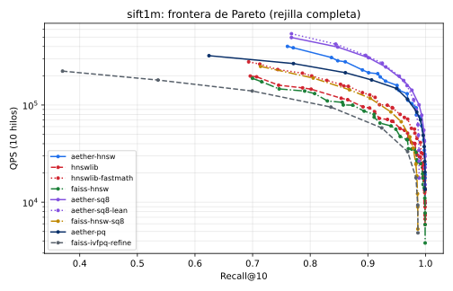
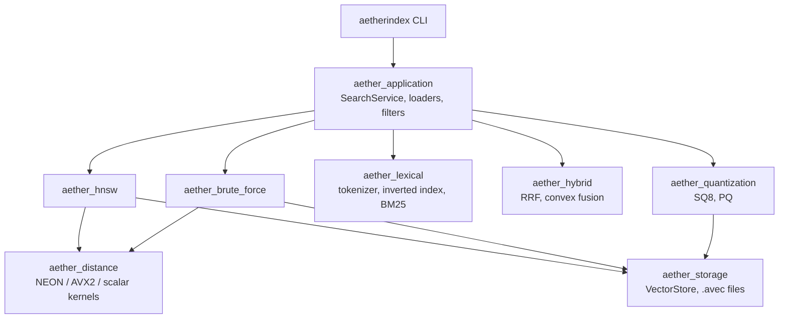

# AetherIndex

[](https://github.com/Esteban-Gonzalez-Cer/aetherindex/actions/workflows/ci.yml)
[](LICENSE)


A hybrid search engine written from scratch in C++20: **HNSW** approximate vector search,
**BM25** lexical retrieval over a compressed inverted index, and **rank fusion** to combine
them. No third-party libraries: the engine, the JSON parser, the CLI and the test harness
are all in this repository.

The project was built to answer one question honestly: *how close can a from-scratch
implementation get to hnswlib, FAISS and Lucene?* Every number below comes from a
reproducible harness that runs the competitors on the same machine, the same data and the
same evaluation code, and the report includes the results where AetherIndex loses.

## Results at a glance

Measured on one machine (Apple M4 Pro, macOS, Apple clang 17). Full protocol, tables and
caveats are in the [market comparison report](docs/reports/MARKET_COMPARISON.md).

| What | AetherIndex | Reference |
|---|---|---|
| ANN throughput, SIFT1M, Recall@10 ≥ 0.95, 10 threads | **159.1 K QPS** | hnswlib 80.1 K (built with `-ffast-math`), FAISS HNSWFlat 47.5 K |
| ANN throughput, GloVe-100, Recall@10 ≥ 0.95 | **12.6 K QPS** | hnswlib 9.0 K, FAISS 5.2 K |
| HNSW build, SIFT1M, 1 thread | **258 s** | FAISS 352 s, hnswlib 366 s |
| BM25 quality, mean nDCG@10 over 6 BEIR datasets | **0.5030** | Lucene 0.5024 (no significant difference on 5 of 6) |
| BM25 latency, 1 thread, FiQA / TREC-COVID / Quora | **0.119 / 0.292 / 0.174 ms** | Lucene 0.165 / 0.384 / 0.214 ms |
| Hybrid quality, mean nDCG@10 over 6 BEIR datasets | **0.6313** (convex fusion) | exact dense search 0.6178, Lucene + exact + RRF 0.6088 |

<p align="center">
  
</p>

What these numbers do not show:

- They come from a single Apple Silicon machine. hnswlib and FAISS have more mature x86
  kernels, so the gap may be smaller or reversed on AVX hardware. This has not been measured.
- The BM25 analyzer that matches Lucene (`english-v1`) is opt-in. The default analyzer
  (`ascii-tech-v1`, no stemming or stopwords) scores below Lucene on all six BEIR datasets.
- Classic RRF fusion scores *below* dense-only search on FiQA, ArguAna and Quora. That
  finding is why the default fusion was changed to a convex combination tuned on dev splits.
- There is no server and no persistence, so comparisons with Qdrant and OpenSearch are
  in-process versus network round trip, and are reported separately for that reason.

## Objective

**AetherIndex aims to beat every competitor on every benchmark cell.** A cell is one
benchmark, dataset and metric. AetherIndex's shipped configuration is compared with the
best competitor configuration measured for that cell. Quality is judged on test splits
with parameters tuned on dev only, and cost on medians of five runs. The full rule is in
[docs/OBJECTIVE.md](docs/OBJECTIVE.md).

Today: **67 of 144 comparable cells won** (49 clearly, 18 inside noise). Of the 61 lost,
33 are inside noise, mostly BM25 quality within 0.001 of Lucene and bm25s. The clear
losses are the no-stemming analyzer, lexical index size on small collections, and parallel
HNSW build against hnswlib with `-ffast-math`. The
[scoreboard](evaluation/reports/market/scoreboard.md) lists every cell, won or not.

## Quick start

Requirements: CMake 3.21+ and a C++20 compiler (GCC, Clang or AppleClang). Nothing else.

```sh
git clone https://github.com/Esteban-Gonzalez-Cer/aetherindex.git
cd aetherindex
cmake --preset release
cmake --build --preset release --parallel
ctest --preset release
```

Then run the three retrieval modes on the bundled sample data:

```sh
# Dense: HNSW over a CSV of vectors
./build/release/aetherindex search --algorithm hnsw \
    --dataset datasets/examples/vectors.csv --query datasets/examples/query.csv --k 2

# Lexical: BM25 over a JSONL corpus
./build/release/aetherindex search --mode lexical \
    --dataset datasets/corpus.jsonl --query datasets/queries.jsonl --query-id Q002 --k 5

# Hybrid: HNSW + BM25, fused
./build/release/aetherindex search --mode hybrid \
    --dataset datasets/hybrid/corpus.jsonl --query datasets/hybrid/queries.jsonl --query-id Q002 --k 5
```

The hybrid query prints its configuration, timings and where each result ranked in each
retriever (output abbreviated):

```text
Search mode: Hybrid
Fusion: convex (alpha=0.65, min-max normalized scores)
Dense retriever: HNSW (Cosine)
Lexical retriever: BM25 (title + text, no field boosts)
...
+------+-------------+----------------+------------+--------------+
| Rank | Document ID | Fused Score    | Dense Rank | Lexical Rank |
+------+-------------+----------------+------------+--------------+
|    1 |        D002 | 0.795486965744 |          8 |            1 |
|    2 |        D019 | 0.681921389620 |          6 |            2 |
|    3 |        D012 | 0.681386373910 |          2 |            5 |
+------+-------------+----------------+------------+--------------+
```

`aetherindex --help` lists every option. The most useful ones:

| Option | Purpose |
|---|---|
| `--mode vector\|lexical\|hybrid` | Retrieval mode |
| `--m`, `--ef-construction`, `--ef-search` | HNSW graph and search width |
| `--quantization sq8\|pq`, `--rerank N` | Traverse compressed codes, re-rank with exact FP32 |
| `--bm25-strategy maxscore\|bmw\|wand\|taat\|exhaustive` | Top-k pruning strategy; all return identical scores |
| `--analyzer english-v1` | Lucene-equivalent English analysis (stopwords, Porter stemming) |
| `--fusion convex\|rrf`, `--alpha A` | Hybrid fusion method and dense weight |
| `--filter F=V`, `--filter-date F=A..B` | Metadata filters |
| `--all-queries --query-threads N` | Batch mode with one index build |
| `convert --out FILE.avec` | Convert CSV/JSONL vectors to a memory-mapped binary format |

## Architecture

A modular monolith of small static libraries with one-way dependencies. Algorithms never
see the CLI, and the CLI never touches storage.



| Module | Path | What it does |
|---|---|---|
| Storage | [`src/storage`](src/storage) | Contiguous, 64-byte-aligned FP32 rows with zero-copy access; memory-mapped `.avec` files |
| Distance | [`src/distance`](src/distance) | Cosine and squared-Euclidean kernels: NEON, AVX2+FMA and a scalar fallback |
| HNSW | [`src/ann/hnsw`](src/ann/hnsw) | Flat adjacency graph, heuristic neighbor selection (Algorithm 4 of the paper), parallel build |
| Quantization | [`src/quantization`](src/quantization) | Scalar (SQ8) and product quantization with exact re-ranking |
| Lexical | [`src/lexical`](src/lexical) | Two analyzers, bit-packed postings, BM25 with MaxScore, Block-Max WAND, WAND and TAAT |
| Hybrid | [`src/hybrid`](src/hybrid) | Reciprocal rank fusion (classic and weighted) and convex score fusion |
| Application | [`src/application`](src/application) | Orchestration, CSV/JSONL loading, metadata filters |
| CLI | [`apps/cli`](apps/cli) | Argument parsing and output only |

## Engineering notes

The parts of this project that took the most thought, and where to read about them:

- **Profiling changed the HNSW design.** The first assumption was that the distance kernel
  dominated query time. A profile showed the cost was cache misses while walking neighbor
  lists. Storing the graph as a flat array and prefetching candidate rows in batches made
  search 1.4–1.7× faster with no change to the kernel, and no `-ffast-math`.
  ([report](docs/reports/MARKET_COMPARISON.md), [HNSW notes](docs/algorithms/hnsw.md))
- **One quality bug was a modelling difference, not a formula bug.** BM25 lost 0.079 nDCG@10
  to Lucene on ArguAna only. The cause: Lucene weights a repeated query term by its
  frequency and AetherIndex counted it once. Two cross-checks (Qdrant and bm25s reproduce
  each behaviour exactly) confirmed it before the default was changed.
- **Pruning strategies are verified to be bit-identical.** MaxScore, Block-Max WAND, WAND and
  TAAT must return exactly the scores of the exhaustive path. A unit test compares 18,960
  query/strategy combinations, including 150-term queries and mass ties.
- **MaxScore replaced Block-Max WAND as the default.** BMW took 7.9 ms on long queries because
  it re-sorts cursors at every step. Windowed MaxScore, the approach Lucene uses, brought
  that to 0.3 ms.
- **The benchmark harness is validated before it is trusted.** Lucene reproduces its published
  BEIR numbers within ±0.005, the in-house evaluator matches `trec_eval`, and the token stream
  of `english-v1` matches Lucene's `EnglishAnalyzer` on 99.993 % of tokens.
- **Determinism is a contract.** A fixed seed and a single build thread give a reproducible
  graph; the CLI has golden-file tests for all three modes.

## Testing

```sh
ctest --preset release          # 74 tests: unit, integration, end-to-end CLI, acceptance
cmake --preset asan && cmake --build --preset asan && ctest --preset asan   # ASan + UBSan
cmake --preset tsan && cmake --build --preset tsan && ctest --preset tsan   # ThreadSanitizer
```

- The suite needs no network, no Python and no external libraries.
- On macOS, run the sanitizer presets with Homebrew LLVM; see [CONTRIBUTING.md](CONTRIBUTING.md).
  The sanitizer runtime shipped with Apple clang 17 hangs at start-up on macOS 26.
- The code builds with `-Wall -Wextra -Wpedantic` and zero warnings; CI enforces it with
  `-Werror`.
- CI builds and tests on Linux (GCC and Clang) and macOS, plus ASan/UBSan and TSan jobs.
- Tests are plain executables registered with CTest rather than a framework, to keep the
  project dependency-free.

## Reproducing the benchmarks

```sh
cmake --preset bench && cmake --build --preset bench --parallel
```

- [`benchmarks/`](benchmarks) holds the in-tree drivers: HNSW parameter sweeps, distance
  kernels, and the optimization suite.
- [`benchmarks/market/`](benchmarks/market/README.md) holds the comparison harnesses for
  hnswlib, FAISS, Lucene, bm25s, Qdrant and OpenSearch, with pinned versions and a
  `docker-compose.yml` for the servers.
- [`evaluation/reports/`](evaluation/reports) keeps the result summaries, per-query runs and
  manifests that the reports cite. Raw logs are not versioned.

Datasets (SIFT1M, GloVe-100, BEIR, DBpedia) are downloaded on demand by the scripts and are
not stored in the repository.

## Roadmap

| Milestone | Status |
|---|---|
| Objective and scoreboard: every benchmark cell tracked, won or not | Done |
| Snapshot persistence: save and load indexes with checksums and memory-mapped loading | Planned |
| Deletes, updates and compaction, with results bit-identical to a fresh build after compaction | Planned |
| Concurrent updates: searches keep running while other threads insert and delete | Planned |
| Write-ahead log: inserts and deletes survive a crash | Planned |
| Close the open scoreboard cells, then widen the margins of the won ones | Planned |

## Limitations

- No persistence yet: every run loads the data and rebuilds the indexes.
- No deletes or concurrent updates yet, and no server mode.
- The engine does not produce embeddings. The vectors in `datasets/hybrid/` are a
  reproducible lexical hashing, useful for testing but not a semantic model.
- The x86 AVX2 kernel is selected at compile time (`-DAETHER_NATIVE_SIMD=ON`); there is no
  runtime dispatch, so a generic x86 binary uses the scalar path.
- Developed and benchmarked on macOS/arm64. Windows (MSVC) is supported in the build files
  but has no recorded test run.

## Documentation

The in-depth documentation and reports were written in Spanish, the working language of the
team.

| Document | Contents |
|---|---|
| [Market comparison](docs/reports/MARKET_COMPARISON.md) | Fairness protocol, all results, and the profiling work behind them |
| [Optimization roadmap](docs/reports/OPTIMIZATION_ROADMAP.md) | Binary format, parallel build, quantization, BM25 strategies, filters |
| [HNSW](docs/algorithms/hnsw.md), [BM25](docs/algorithms/bm25.md), [RRF](docs/algorithms/rrf.md) | Algorithm contracts and design decisions |
| [Vector store and distances](docs/algorithms/vector_store_and_distances.md) | Storage layout and kernel contracts |
| [CLI reference](docs/cli.md) | Every option, input formats and exit codes |
| [Architecture](docs/architecture/README.md) | Module responsibilities and dependency rules |

## Team

AetherIndex started as a three-person team project, developed in sprints.

- [Esteban-Gonzalez-Cer](https://github.com/Esteban-Gonzalez-Cer): project architecture,
  vector store and distance kernels, the BM25 engine and its pruning strategies, rank
  fusion, quantization, the performance work and the market comparison campaign.
- [JuanAngelRivera](https://github.com/JuanAngelRivera): the first HNSW graph and layer
  search, BM25 integration into the CLI, the JSON loader and the labelled test corpus.
- [kr-zvr](https://github.com/kr-zvr): HNSW level hierarchy.

## License

[MIT](LICENSE)
