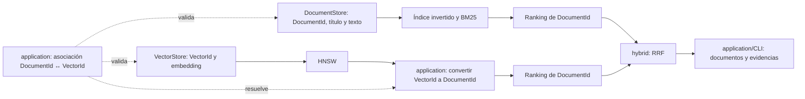

# Análisis de requisitos y datos para la recuperación híbrida

**Proyecto:** AetherIndex · **Tarjeta:** Analizar requisitos y datos para la recuperación híbrida

**Fecha de revisión:** 21 de octubre de 2026 · **Estado:** análisis y propuesta de contratos; implementación pendiente.

**Actualización del 25 de octubre de 2026:** CP-02 implementa BM25 con los contratos
de [su especificación técnica](../algorithms/bm25.md): `DocumentId` como alias uint32,
perfil conservador `ascii-tech-v1`, documentos vacíos admitidos y consultas vacías
que devuelven un ranking vacío. Esas decisiones posteriores sustituyen las
propuestas de normalización Unicode completa, IDs fuertes y rechazo de vacíos
de este análisis inicial. RRF y la orquestación híbrida siguen pendientes.

**Actualización del 26 de octubre de 2026:** [CP-03](../algorithms/rrf.md)
implementa la fusión RRF independiente, con `k_rrf` double positivo y rankings
documentales. Su contrato sustituye la propuesta inicial de constante entera;
la orquestación híbrida y las políticas de candidatos siguen en CP-04.

## 1. Resultado esperado de esta tarjeta

Definir la información y los contratos necesarios para recuperar documentos mediante BM25 y HNSW y combinar ambos rankings. La unidad del resultado final será el **documento**, identificado mediante `DocumentId`.

La recomendación para la primera implementación es:

- Reutilizar las 10,000 descripciones de entidades DBpedia y sus embeddings de 1,024 dimensiones.
- Representar cada documento mediante título, texto, identidad de origen y metadatos de trazabilidad.
- Mantener inicialmente una relación **un documento ↔ un embedding**, con un enlace explícito entre `DocumentId` y `VectorId`.
- Ofrecer tres modos: léxico, vectorial e híbrido. El híbrido recibirá texto y un embedding de consulta compatible, calculado fuera del motor.
- Implementar BM25 con un índice invertido y fusionar rankings mediante Reciprocal Rank Fusion, RRF.
- Evaluar por separado corrección matemática, integridad de datos, aproximación de HNSW, relevancia y rendimiento.

Estas son **propuestas para las siguientes tarjetas**, no capacidades que la CLI ya tenga. Esta tarjeta no implementa BM25, RRF, generación de embeddings ni nuevos comandos.

## 2. Punto de partida verificado en el repositorio

| Componente | Estado actual | Consecuencia para la integración |
|---|---|---|
| `VectorStore` | Implementado; embeddings FP32, dimensión y métrica fijas, IDs externos `uint32_t` | Se reutiliza como propietario de los embeddings. |
| Fuerza bruta | Implementada | Referencia exacta para medir la aproximación vectorial. |
| HNSW | Implementado; topología separada de los embeddings | Se reutiliza para obtener candidatos vectoriales; no necesita conocer el texto. |
| `QueryEngine` | Busca con un embedding numérico sobre un store o un índice HNSW | Falta la orquestación de consultas de texto e híbridas. |
| `SearchService` y CLI | Cargan CSV numérico; seleccionan fuerza bruta o HNSW; reconstruyen los datos por invocación | Falta cargar documentos y asociaciones. No existe un modelo de embeddings dentro de AetherIndex. |
| `SearchResult` | Contiene `VectorId id` y `float distance`; menor distancia es mejor | No debe reutilizarse su campo `distance` para almacenar un score BM25 o RRF. |
| `DocumentId` y `DocumentStore` | Pendientes | Hay que definir la identidad y el almacenamiento del documento. |
| `lexical/` y `hybrid/` | Directorios reservados, sin implementación | Tokenizer, índice invertido, BM25 y RRF son trabajo nuevo. |

La [arquitectura vigente](README.md) ya asigna `DocumentStore` a `storage`, BM25 a `lexical`, RRF a `hybrid` y la asociación entre documentos y vectores a `application`.

Contratos revisados: [tipos comunes](../../include/aether/core/types.hpp), [resultado vectorial](../../include/aether/core/search_result.hpp), [VectorStore](../../include/aether/storage/vector_store.hpp), [QueryEngine](../../include/aether/application/query_engine.hpp), [SearchService](../../include/aether/application/search_service.hpp) y su [implementación](../../src/application/search_service.cpp).

## 3. Caso de uso y datos disponibles

### 3.1 Caso inicial: recuperación de artículos de una base de conocimiento

Una persona puede buscar una entidad por su nombre, describir una necesidad con otras palabras o pedir artículos relacionados con otro artículo. Esto permite evaluar el aporte de coincidencias léxicas y similitud vectorial sobre el mismo catálogo.

BM25 ordena coincidencias de términos; HNSW aproxima los vecinos del embedding de consulta. Una consulta con el nombre de una entidad y otra que describe un concepto pueden favorecer canales distintos. **Que sus señales sean complementarias es una hipótesis de trabajo: el beneficio híbrido debe medirse.**

El corpus publicado por [Qdrant en Hugging Face](https://huggingface.co/datasets/Qdrant/dbpedia-entities-openai3-text-embedding-3-small-1024-100K) identifica el idioma como inglés y expone ID de origen, título, texto y embedding. Para el piloto se recomienda consultar en inglés; las pruebas de Unicode incluirán español, pero no demostrarán por sí mismas calidad de recuperación multilingüe.

### 3.2 Inventario local revisado

Los siguientes datos se comprobaron leyendo los archivos locales existentes, sin descargar ni modificar el corpus:

| Elemento | Disponibilidad y uso |
|---|---|
| Catálogo | 10,000 registros en `datasets/real/dbpedia/articles.jsonl`. |
| Identidad | 10,000 `source_id` distintos y 10,000 `vector_id` distintos. |
| Texto | Todos los registros tienen texto no vacío; 3,261,684 bytes UTF-8 en el campo `text`, sin contar títulos ni estructura JSON. |
| Embeddings | El manifiesto declara 10,000 vectores de dimensión 1,024 y modelo `text-embedding-3-small`; `vectors.csv` es la entrada vectorial existente. |
| Consultas disponibles | 20 artículos separados del catálogo, con texto, título y archivo de embedding asociado en `queries.json`. |
| Procedencia | Revisión de la fuente `d49822cb2465295366349d414679b476997e88f5`; filas del catálogo 0–9,999 y de consulta 10,000–10,019. |
| Mapeo existente | `VectorId = 7 * source_row + 10`. No existe todavía `DocumentId`. |
| Juicios de relevancia | No hay qrels en este flujo: el script de preparación no genera etiquetas humanas de relevancia. |

El [script de preparación](../../scripts/prepare_real_dataset.py) conserva `source_row`, `source_id`, `title` y `text` junto a `vector_id`. Por ello, no es necesario obtener otro corpus para iniciar BM25. Sí hace falta transformar ese material al contrato documental y preparar la evaluación híbrida.

El inventario confirma correspondencia por registro, no la receta exacta usada por el proveedor para generar el embedding. Los metadatos actuales no documentan si se incrustó `text`, `title + text`, alguna plantilla, ni una revisión exacta del modelo. Esa procedencia se registrará como **no publicada**, sin inventar una plantilla. No se presentará esta importación como reproducción completa del proceso de generación.

Las 20 consultas actuales sirven para experimentar con **artículos relacionados**. No son 20 preguntas breves redactadas por usuarios, ni equivalen a una evaluación de búsqueda conversacional.

La preparación, atribución y limitaciones de la fuente se describen en [el caso real existente](../real_world_validation.md). Esta tarjeta no cambia las condiciones de distribución de esos datos.

## 4. Representación de documentos y asociación con embeddings

### 4.1 Identidades diferentes

| Identificador | Significado | Contrato propuesto |
|---|---|---|
| `DocumentId` | Identidad estable del documento dentro del corpus | Entero sin signo de 32 bits; admitir cero y todo el rango. Representarlo como tipo distinto de `VectorId` para evitar intercambios accidentales. |
| `VectorId` | Identidad externa del embedding en `VectorStore` | Conservar el contrato actual `std::uint32_t`. |
| ID de origen | Identidad del contenido en el sistema fuente | Cadena UTF-8; clave única compuesta por `source` y `source_id`. |
| `InternalId`/posición HNSW | Ubicación densa utilizada por el grafo | Detalle interno del índice; no se exporta como identidad de documento ni se usa como clave de fusión. |

Los valores de `DocumentId` y `VectorId` podrían coincidir numéricamente, pero esa coincidencia nunca será la relación contractual. La aplicación resolverá una asociación explícita.

Ejemplo de **asignación propuesta** para importar el corpus local, sin alterar sus `VectorId`:

| `source_row` | `source_id` | Título real | `DocumentId` propuesto | `VectorId` actual |
|---|---|---|---:|---:|
| 0 | `<dbpedia:Parabolic_reflector>` | Parabolic reflector | 100000 | 10 |
| 1 | `<dbpedia:John_Baird_(Canadian_politician)>` | John Baird (Canadian politician) | 100001 | 17 |

`DocumentId = 100000 + source_row` es una regla reproducible para esta revisión concreta del dataset. No debe generalizarse a otras fuentes ni recalcularse desde el orden de llegada. El archivo de asociaciones conservará las asignaciones; una reimportación de la misma revisión deberá producir las mismas identidades.

### 4.2 Diccionario del documento

| Campo | Tipo lógico | Obligatorio | Regla y propósito |
|---|---|---|---|
| `document_id` | `DocumentId` | Sí | Único dentro del corpus. |
| `title` | Cadena UTF-8 | Sí; puede estar vacía | Nombre para resultados y contenido léxico. |
| `text` | Cadena UTF-8 | Sí | Texto original del registro, conservado íntegro. El documento debe producir al menos un token al analizar título y texto. |
| `source` | Cadena no vacía | Sí | Espacio de nombres de la fuente; por ejemplo, `dbpedia`. |
| `source_id` | Cadena no vacía | Sí | Identidad externa; no se transforma con el tokenizer. |
| `language` | Etiqueta de idioma | Sí | Declarada en la importación; `en` para este piloto. No implica detección automática. |
| `content_revision` | Cadena no vacía | Sí | Revisión o hash del contenido con serialización definida por el importador. Permite detectar texto modificado con embeddings antiguos. |
| `source_uri` | Cadena | No | Enlace de procedencia, si está disponible y validado. |
| `metadata` | Pares de cadenas | No | Datos descriptivos; no se indexan ni filtran implícitamente. |

`DocumentStore` será propietario del texto. El índice invertido almacenará referencias por `DocumentId`, no copias completas del documento. El campo léxico inicial será `title + "\n" + text`, sin multiplicar el título ni aplicar pesos por campo. Una repetición presente en ambos campos contará como dos ocurrencias reales en ese campo combinado.

Para `content_revision`, el importador deberá fijar el orden de campos, codificación y delimitación del hash. Se recomienda SHA-256 sobre una serialización canónica de los valores originales de `title` y `text`; el análisis léxico se versiona aparte. Cambiar cualquiera de ellos obliga a revisar también la asociación semántica del embedding.

### 4.3 Asociación explícita

La primera versión híbrida exige una biyección entre documentos del corpus híbrido y embeddings: cada documento tiene exactamente un vector y cada vector pertenece a un documento.

La asociación mínima contendrá:

| Campo | Uso |
|---|---|
| `document_id` | Referencia a un documento existente. |
| `vector_id` | Referencia a un embedding existente. |
| `content_revision` | Debe coincidir con la revisión del documento asociado. |
| `embedding_profile_id` | Identifica el modelo, dimensión, procedencia y preprocesamiento declarados en el manifiesto del corpus. |

Se requieren las dos consultas: documento → vector, para inspección e integridad, y vector → documento, para convertir resultados de HNSW. La aplicación posee y valida esta relación. HNSW sigue accediendo a embeddings mediante `VectorStore`; BM25 sigue operando con `DocumentId`.

El diagrama describe el flujo de información propuesto, no dependencias de compilación.

**Fragmentos:** dividir documentos y almacenar varios embeddings por documento queda fuera de la primera implementación. Una extensión posterior requerirá `ChunkId`, límites del fragmento y su versión de contenido. También deberá colapsar los resultados por documento y recalcular posiciones antes de RRF; de otro modo, un documento con muchos fragmentos recibiría contribuciones repetidas. No se implementará esa cardinalidad de forma implícita.

### 4.4 Manifiesto y formato de intercambio

Se propone separar tres archivos de entrada: `documents.jsonl`, `vectors.csv` con el esquema numérico actual y `bindings.jsonl` con las asociaciones. JSONL permite representar texto con comas, comillas y saltos de línea escapados. Su lectura será responsabilidad de `application`; no constituye persistencia binaria de los índices.

El manifiesto del corpus deberá registrar:

- Versión de esquema, `corpus_id`, revisión de la fuente, rutas, cantidades y checksums de los tres archivos.
- Perfil léxico: versión del analyzer, reglas de tokens y versión de los datos Unicode empleados.
- Perfil de embedding: proveedor, nombre de modelo, revisión exacta cuando se conozca, dimensión, FP32, métrica y transformación de almacenamiento. Para coseno, conservar la normalización que ya realiza `VectorStore`.
- Unidad representada: documento completo; plantilla de entrada y truncamiento cuando sean conocidos. Los valores desconocidos se declaran explícitamente.
- Regla/registro de asignación de IDs, configuración HNSW y orden de inserción para reproducir experimentos.

Tener la misma dimensión **no demuestra** que dos modelos produzcan espacios compatibles. La aplicación verificará los perfiles declarados de corpus y consulta. La veracidad de la procedencia y la correspondencia semántica entre texto y embedding dependen también del productor de los datos; no se pueden deducir solo de los números.

## 5. Requisitos de análisis léxico y datos de BM25

### 5.1 Perfil inicial propuesto: `unicode-word-v1`

El mismo analyzer, con idéntica versión y configuración, se aplicará al contenido indexado y al texto de consulta:

1. Validar UTF-8. Rechazar secuencias inválidas; conservar el original para presentación.
2. Normalizar a NFC, aplicar Unicode case folding independiente de la configuración regional y volver a NFC.
3. Formar tokens que empiecen por letra o número Unicode y continúen con letras, números o marcas combinantes. Admitir `-` y `_` ASCII únicamente entre letras/números dentro del token.
4. Tratar el resto de puntuación y espacios como separadores. No interpretar operadores de consulta.
5. Conservar diacríticos, números y palabras frecuentes. No aplicar stemming, sinónimos ni listas de stopwords en esta primera versión.

NFC permite unificar representaciones canónicamente equivalentes de caracteres; la elección de NFC y la conservación de acentos son decisiones de este perfil, basadas en [Unicode UAX #15](https://www.unicode.org/reports/tr15/).

| Entrada | Tokens esperados en este perfil |
|---|---|
| `Parabolic REFLECTOR` | `parabolic`, `reflector` |
| `REFLEXIÓN` | `reflexión` |
| `reflexio\u0301n` — `o` seguida de acento combinante | `reflexión` |
| `error E-1042` | `error`, `e-1042` |
| `radio_wave` | `radio_wave` |
| `radio-wave` | `radio-wave`; no se expande automáticamente a `radio`, `wave` |
| `"flight test" OR squadron` | `flight`, `test`, `or`, `squadron`; sin frase exacta ni operador OR |
| `!!!` o solo espacios | Ningún token; consulta rechazada como vacía tras análisis. |

Conservar `e-1042` permite buscar ese identificador como término completo. No equivale a ofrecer coincidencia literal de cualquier expresión: `C++`, `C#`, URLs y puntuación no contemplada necesitarían reglas adicionales. Esas necesidades deberán validarse con el futuro dominio técnico antes de ampliar este perfil.

Para implementar normalización, categorías y case folding se recomienda evaluar **utf8proc**, que ofrece estas operaciones y soporte C/C++ multiplataforma. El proyecto documenta licencia MIT y condiciones adicionales de los datos Unicode. Se fijará una versión y se conservarán sus avisos al incorporarlo; no se agrega la dependencia en esta tarjeta. Referencias: [documentación oficial](https://juliastrings.github.io/utf8proc/) y [licencia](https://github.com/JuliaStrings/utf8proc/blob/master/LICENSE.md).

La dependencia Unicode quedaría encapsulada en `lexical`; `core`, `VectorStore`, distancias y HNSW no deben adquirirla. Cambiar el analyzer obliga a reconstruir el índice léxico.

### 5.2 Información derivada que necesita el índice invertido

| Dato | Definición contractual |
|---|---|
| Vocabulario | Token normalizado → `TermId` interno. `TermId` no identifica documentos ni vectores. |
| Postings | Por término, pares únicos `(DocumentId, tf)`; una entrada por documento, aunque el término aparezca muchas veces. |
| `tf(t,d)` | Número de ocurrencias del término en el campo combinado del documento. |
| `df(t)` | Número de documentos que contienen el término; no suma de ocurrencias. |
| `dl(d)` | Cantidad de tokens del documento después de aplicar el analyzer; incluye repeticiones. |
| `N` | Número de documentos válidos del índice léxico. En el corpus híbrido inicial coincide con documentos, asociaciones y vectores. |
| `avgdl` | Suma de `dl(d)` dividida entre `N`; para `N = 0`, no ejecutar la fórmula y devolver un ranking vacío para una consulta válida. |

Los contadores se comprobarán frente a desbordamientos. No se necesitan posiciones de términos para BM25 básico; por ello, la primera versión no prometerá frases exactas ni proximidad de palabras. La búsqueda recorrerá postings de términos de consulta y puntuará la unión de documentos coincidentes; no exigirá que aparezcan todos los términos.

### 5.3 Variante matemática fijada para evitar ambigüedad

Se propone la siguiente variante de BM25, con logaritmo natural e IDF suavizado positivo:

$$
\operatorname{IDF}(t)=\ln\left(1+\frac{N-df(t)+0.5}{df(t)+0.5}\right)
$$

$$
\operatorname{BM25}(q,d)=\sum_{t\in U(q)}\operatorname{IDF}(t)
\frac{tf(t,d)(k_1+1)}{tf(t,d)+k_1\left(1-b+b\frac{dl(d)}{avgdl}\right)}
$$

`U(q)` contiene los términos distintos de la consulta. Para esta versión no se pondera su frecuencia de repetición. Términos fuera del vocabulario no contribuyen. No se devolverán documentos de score cero para rellenar K.

La saturación de frecuencia y normalización de longitud corresponden a la formulación explicada en [Introduction to Information Retrieval, sección BM25](https://nlp.stanford.edu/IR-book/html/htmledition/okapi-bm25-a-non-binary-model-1.html). El IDF positivo y los valores iniciales `k1 = 1.2`, `b = 0.75` siguen las convenciones documentadas de [Lucene BM25Similarity 10.3.1](https://lucene.apache.org/core/10_3_1/core/org/apache/lucene/search/similarities/BM25Similarity.html). Se fija esta fórmula para pruebas propias; no se promete igualdad numérica completa con Lucene, que tiene otros detalles de implementación.

Requisitos adicionales de esta propuesta:

- `k1` finito y mayor que cero; `b` finito en `[0,1]`. Validar configuración antes de construir/buscar.
- Calcular scores y estadísticas usadas en la fórmula con `double`; mantener intacto el contrato FP32 de las distancias vectoriales.
- Mayor score BM25 significa mejor resultado; desempatar por `DocumentId` ascendente.
- Empezar con los valores anteriores y ajustarlos solo con consultas de desarrollo, sin usar el conjunto final de evaluación para elegirlos.
- No incorporar pesos de título, BM25F, expansión de consulta ni aprendizaje de ranking en esta tarjeta.

## 6. Tipos de consulta y comportamiento esperado

### 6.1 Modos de recuperación

Separar el **modo de recuperación** (`lexical`, `vector`, `hybrid`) del **algoritmo vectorial** (`brute-force`, `hnsw`). Esto evita presentar BM25 o RRF como otra variante de vecino más cercano. La CLI actual todavía no tiene esta separación.

| Modo propuesto | Entrada necesaria | Ejecución | Resultado |
|---|---|---|---|
| Léxico | Texto no vacío después del analyzer | BM25 | Documentos con score BM25. |
| Vectorial | Embedding válido y perfil compatible | HNSW; fuerza bruta disponible como referencia | Vecinos vectoriales; en una vista documental, resolver su asociación. El modo numérico existente conserva su contrato. |
| Híbrido | Texto válido + embedding compatible que represente la misma necesidad | BM25 y HNSW sobre el mismo corpus; conversión a documentos y RRF | Documentos únicos con score RRF y procedencia de cada canal. |

**AetherIndex no convertirá texto a vectores en esta primera integración.** El cliente o un preparador externo suministrará el embedding. Recibir una cadena junto a un vector no demuestra que expresen la misma intención; el productor deberá declarar esa correspondencia y el perfil utilizado.

Contrato conceptual de una solicitud documental, todavía sin API pública ni flags implementados: modo, texto opcional, embedding opcional, perfil de embedding, K final, presupuesto de candidatos por canal y configuración de recuperación. Los campos obligatorios dependen del modo según la tabla.

### 6.2 Necesidades de información del piloto

| Familia | Ejemplo de consulta en inglés | Qué se quiere comprobar |
|---|---|---|
| Nombre de entidad | `Parabolic reflector` | Recuperación por términos de un título existente. |
| Desambiguación | `John Baird Canadian politician` | Distinguir entidades mediante contexto y términos específicos. |
| Descripción conceptual | `reflective dish that collects radio waves` | Recuperación con una formulación distinta del nombre de la entidad. |
| Combinación de nombre y necesidad | `parabolic reflector radio waves` | Aporte conjunto de coincidencias de términos y cercanía vectorial. |
| Artículos relacionados | Título/texto y embedding del artículo de consulta separado del catálogo | Reutilizar las consultas publicadas actuales sin insertarlas entre los candidatos. |
| Término raro o identificador | Un identificador presente y otro ausente del corpus de prueba | Verificar reglas del analyzer y ausencia de coincidencias inventadas. |

Los ejemplos expresan necesidades de prueba; no son resultados medidos ni qrels. Un nombre que está en el título no obliga a BM25 o RRF a colocarlo primero sin verificar los scores y las etiquetas de evaluación.

### 6.3 Validaciones y casos límite

- K final debe ser positivo en la interfaz de aplicación/CLI, como ya exige `SearchService`. Los límites y comportamientos de las APIs vectoriales internas existentes no cambian en esta tarjeta.
- K significa **hasta K resultados**. Si la unión de candidatos contiene menos documentos, devolver menos y mostrar solicitados/devueltos. No duplicar resultados para completar K.
- Texto vacío o sin tokens es entrada inválida en modo léxico/híbrido. Una consulta válida cuyos términos no existen en el vocabulario devuelve un ranking léxico vacío.
- En híbrido, un ranking léxico vacío por ausencia de coincidencias es válido: RRF usa las contribuciones vectoriales e informa que BM25 aportó cero candidatos. Un error de lectura, índice corrupto o embedding ausente/incompatible se reporta como error; no se convierte silenciosamente en otro modo.
- Con corpus vacío y consulta válida, devolver cero resultados sin evaluar BM25 con `avgdl = 0`.
- Validar embedding con las reglas actuales de dimensión, finitud y métrica. La normalización de texto para BM25 no se aplicará a los componentes numéricos ni alterará retroactivamente el texto que recibió el modelo de embeddings.
- Los índices de ambas ramas y las asociaciones deben pertenecer a la misma revisión del corpus. Un `VectorId` sin documento es un error de integridad, no un candidato que se omite silenciosamente.
- No interpretar comillas, `AND`, `OR`, negaciones, comodines o filtros como sintaxis especial. Búsqueda exacta de frases, traducción, corrección ortográfica y filtros por metadatos quedan para contratos posteriores.

### 6.4 Información de consultas y juicios para experimentos

El conjunto de consultas deberá poder conservarse independientemente de la CLI:

| Campo del registro de consulta | Regla |
|---|---|
| `query_id` | Cadena única y estable dentro del conjunto de evaluación. |
| `text` | Texto original, obligatorio para evaluar BM25 e híbrido. |
| `language`, `intent` | Idioma y familia de necesidad de información; no se infieren desde el embedding. |
| `embedding_file`, `embedding_profile_id` | Vector externo y procedencia, obligatorios para evaluar HNSW e híbrido. |
| `source_id` | Opcional; identifica el artículo de consulta cuando se evalúan artículos relacionados, sin convertirlo en candidato del catálogo. |
| `split` | Desarrollo o evaluación final; se fija antes de ajustar parámetros. |

Los juicios se almacenarán por separado como `(query_id, document_id, relevance_grade)`. Un documento no juzgado no se etiquetará automáticamente como irrelevante en el archivo maestro. Las etiquetas no se deducirán del score BM25, de una distancia ni de la salida de HNSW.

## 7. Integración de resultados mediante RRF

### 7.1 Preparar candidatos del mismo dominio

El flujo propuesto es:

1. BM25 obtiene hasta `candidate_k_lexical` documentos ordenados por score descendente.
2. HNSW obtiene hasta `candidate_k_vector` vectores ordenados por distancia ascendente.
3. La aplicación resuelve sus `VectorId` a `DocumentId`; en el MVP la relación 1:1 conserva el número de candidatos. Ordenar los candidatos documentales de igual distancia por `DocumentId` para estabilizar su ranking.
4. Cada lista entregada a RRF contiene documentos únicos, ordenados y con posiciones consecutivas desde 1.
5. RRF opera sobre la **unión** de las dos listas. Se ordena por score RRF descendente y luego `DocumentId` ascendente; se trunca al K final.

Se propone comenzar con `candidate_k_lexical = candidate_k_vector = max(50, K)` y constante RRF `c = 60`, todos configurables y registrados. Los presupuestos deben ser positivos y al menos K. Para HNSW, `efSearch` debe dimensionarse junto con el presupuesto vectorial: la implementación actual usa efectivamente `min(N, max(k, efSearch))`, donde aquí `k` será el número de candidatos vectoriales solicitado, no necesariamente el K final.

Estos valores son una configuración inicial de experimentación, no un óptimo demostrado. Cambiar la profundidad de las listas puede cambiar el resultado de RRF, aunque el K final sea el mismo. La fusión no puede recuperar un documento que ninguna rama incluyó en sus candidatos.

El número efectivo de candidatos de cada canal se limita al tamaño del corpus. Un K mayor que N no debe provocar reservas proporcionales a ese K cuando solo existen N documentos; tampoco cambia la regla de devolver hasta K.

### 7.2 Fórmula y semántica

$$
\operatorname{RRF}(d)=\sum_{r\in\{lexical,vector\}:d\in r}\frac{1}{c+rank_r(d)}
$$

Se recomienda la suma sin pesos y `c = 60` como punto de partida del [artículo original de Cormack, Clarke y Büttcher, SIGIR 2009](https://cormack.uwaterloo.ca/cormacksigir09-rrf.pdf). El nombre `c` evita confundir esta constante con el K de resultados. Usar `c` entero positivo configurable y acumulación `double`.

Un documento ausente de una lista aporta cero por esa rama, sin asignarle una posición ficticia. La fusión utiliza posiciones: **no suma score BM25 con distancia coseno**. Conservar ambos valores como evidencias separadas. RRF no produce una distancia ni una probabilidad de relevancia.

Ejemplo de contrato, con rankings ilustrativos sobre IDs documentales propuestos:

- BM25: `100000`, `100001`, `100002`.
- HNSW ya convertido a documentos: `100002`, `100000`, `100003`.

| Documento | Posición BM25 | Posición vectorial | Score RRF con `c = 60` | Orden final |
|---:|---:|---:|---:|---:|
| 100000 | 1 | 2 | 0.032522474881 | 1 |
| 100002 | 3 | 1 | 0.032266458496 | 2 |
| 100001 | 2 | Ausente | 0.016129032258 | 3 |
| 100003 | Ausente | 3 | 0.015873015873 | 4 |

Las posiciones permiten comprobar la integración sin depender de escalas arbitrarias. Este ejemplo no es un experimento de relevancia sobre DBpedia.

### 7.3 Contrato de respuesta y tiempos

Conservar `SearchResult` para la búsqueda vectorial existente. Proponer un resultado documental distinto que contenga:

| Campo | Condición |
|---|---|
| `document_id` y posición final | Siempre. |
| Título y referencia al documento | Resueltos por aplicación para la presentación. |
| `bm25_score`, `lexical_rank` | Opcionales: solo cuando esa rama aportó el documento. |
| `vector_id`, `vector_distance`, `vector_rank` | Opcionales: solo cuando la rama vectorial aportó el documento. |
| `rrf_score` | En modo híbrido; mayor es mejor. |
| Corpus, perfiles y configuración efectivos | En metadatos de la respuesta/reporte. |

Ausencia de contribución se representará como ausencia, no como cero de distancia: `0.000000000` es una distancia vectorial válida. La presentación conservará IDs enteros, distancias con nueve decimales y tablas con bordes; los scores tendrán columnas con su nombre y sentido propios.

Medir con reloj monotónico, sin alterar el significado del `query_time` vectorial actual:

- Carga y validación de entradas, construcción léxica y construcción HNSW: tiempos separados.
- Nueva consulta híbrida: análisis de texto, BM25, HNSW, conversión/fusión y tiempo total de recuperación. El total comienza con los índices preparados y entradas en memoria; incluye validación de consulta y termina al producir la respuesta documental.
- Mostrar el alcance de cada tiempo. La lectura de archivos de consulta y la impresión quedan fuera de ese total; la generación externa del embedding también. Si posteriormente se mide la experiencia completa, publicar otra métrica de extremo a extremo.

La primera implementación puede ejecutar las ramas secuencialmente. Esta tarjeta no introduce concurrencia ni asume que el tiempo total sea el máximo de ambas ramas.

## 8. Requisitos funcionales e integridad

Todos los requisitos siguientes son de la **implementación prevista**, salvo la conservación explícita de contratos existentes.

| ID | Requisito | Evidencia de aceptación prevista |
|---|---|---|
| RF-01 | Ingerir documentos y asociaciones con validación de esquema, identidad y revisión. | Importación válida y rechazos de duplicados, campos inválidos y referencias inexistentes. |
| RF-02 | Recuperar un documento por `DocumentId` sin usar la posición HNSW. | Título/texto originales e identidad de origen correctos; ausencia explícita para ID inexistente. |
| RF-03 | Analizar texto y consultas con el mismo perfil versionado. | Fixtures Unicode, acentos, números y guiones de la sección 5.1. |
| RF-04 | Construir postings y estadísticas BM25 consistentes. | `tf`, `df`, longitudes, N y media comprobados independientemente. |
| RF-05 | Buscar con BM25 según la fórmula y orden definidos. | Referencias numéricas, términos ausentes, repetidos y desempates. |
| RF-06 | Reutilizar HNSW y fuerza bruta con sus contratos vectoriales. | Pruebas existentes conservadas y asociación correcta de sus resultados a documentos. |
| RF-07 | Fusionar mediante RRF por `DocumentId` con posiciones desde 1. | Ejemplo de la sección 7.2, listas disjuntas, coincidentes, vacías y empates. |
| RF-08 | Separar modos de recuperación y campos de solicitud obligatorios. | Rechazo de híbrido sin texto/embedding o con perfil incompatible; léxico sin necesidad de embedding de consulta. |
| RF-09 | Devolver hasta K documentos únicos y procedencia por rama. | K mayor que corpus/unión, candidato en una o dos ramas y valores opcionales correctos. |
| RF-10 | Evitar publicar un corpus híbrido parcialmente construido. | Fallos de carga/construcción dejan la nueva instancia no disponible y sin modificar una instancia previa válida. |
| RF-11 | Exponer tiempos por etapa y configuración efectiva. | Prueba del alcance de medición y reporte reproducible, separado de carga y construcción. |
| RF-12 | Permitir comparar BM25, HNSW e híbrido sobre una revisión común. | Ejecuciones con mismo catálogo, consultas, asociaciones y etiquetas; reporte de calidad y coste. |

### Restricciones transversales

| ID | Requisito no funcional |
|---|---|
| RNF-01 | Respetar las dependencias de la sección 9 y mantener fórmulas y tokenización fuera de la CLI. |
| RNF-02 | Con los mismos datos, analyzer, parámetros, orden de inserción y semilla, producir resultados reproducibles en el mismo entorno; documentar diferencias numéricas entre plataformas. |
| RNF-03 | Conservar C++20/CMake y soporte macOS, Windows y Linux; evitar que el analyzer dependa de la configuración regional del proceso. |
| RNF-04 | Definir límites configurables de bytes por documento/consulta y cantidad de registros antes de implementar el importador; rechazar excesos y desbordamientos con diagnóstico, sin truncamiento silencioso. |
| RNF-05 | Conservar un solo propietario por texto/embedding y medir por separado memoria de documentos, postings, asociaciones y grafo. El límite anterior de topología HNSW no es un límite para el nuevo corpus completo. |
| RNF-06 | Registrar versión de código, perfiles, corpus y configuración en los experimentos; mantener la evaluación de calidad separada de las pruebas de corrección. |

### Consistencia de construcción

La inserción transaccional de `VectorStore` no proporciona una transacción entre documentos, postings y grafo. Además, HNSW puede exigir reconstrucción cuando falla después de mutar el grafo; no debe suponerse rollback automático entre módulos.

Para la primera versión se recomienda:

1. Validar archivos, identidades, perfiles y asociaciones del lote completo.
2. Construir una nueva instancia propietaria de documentos, vectores, asociaciones e índices, fuera de la instancia consultable.
3. Comprobar cardinalidades y referencias antes de devolverla como lista para consultas.
4. Descartar toda la nueva instancia si falla cualquier etapa. Si existe una instancia previa, conservarla; en la CLI de una sola ejecución, finalizar la carga con error antes de buscar.

Es publicación lógica de una instancia en memoria, sin implicar escritura atómica a disco ni servidor concurrente. El objeto que agrupe el corpus deberá respetar el lifetime actual: destruir HNSW antes que su `VectorStore` y no conservar spans entre inserciones. La versión inicial construirá el corpus antes de buscar; actualizaciones y borrados quedan fuera del alcance.

Invariantes exigidas para el corpus híbrido inicial:

- `document_count = binding_count = vector_count = lexical_document_count = hnsw_indexed_count`.
- Cada asociación apunta a un documento y un vector existentes y de la revisión esperada.
- No hay dos asociaciones para un documento o para un vector; no se fusiona por título ni por texto idéntico.
- Un documento sin tokens, un vector inválido o un ID de origen duplicado dentro de su fuente invalidan el lote; no se omiten registros silenciosamente.
- Una carga exclusivamente vectorial ya existente no queda obligada a aportar documentos. Un modo léxico independiente podrá construir solo documentos/postings; el conjunto completo y sus invariantes son obligatorios al declarar el corpus como híbrido.

## 9. Distribución arquitectónica propuesta

| Módulo | Responsabilidad nueva | Dependencias y límites |
|---|---|---|
| `core` | `DocumentId` y tipos pequeños de resultados documentales/rankings | Biblioteca estándar; no conoce JSON, BM25 ni HNSW. |
| `storage` | `DocumentStore`, propiedad del texto y recuperación por ID | `core`; no tokeniza ni calcula relevancia. |
| `lexical` | Analyzer, vocabulario, postings, estadísticas y BM25 | `core`, `storage`; backend Unicode encapsulado. No llama a HNSW ni abre archivos de CLI. |
| `ann/hnsw` | Recuperación vectorial existente | Conserva sus dependencias actuales. No conoce `DocumentStore` ni RRF. |
| `hybrid` | Fusión de listas documentales ordenadas | `core`; no requiere enlazar BM25, HNSW ni los stores. |
| `application` | Importación, asociaciones, lifecycle del corpus y orquestación de consultas | Usa los módulos anteriores; aquí se valida y transforma el dominio vectorial a documental. |
| `apps/cli` | Parseo de opciones y presentación | Usa `application`; no contiene fórmulas BM25, tokenizer ni fusión. |

Los futuros headers públicos seguirán en `include/aether/` y sus implementaciones en `src/`: `storage/document_store`, `lexical/tokenizer`, `lexical/inverted_index`, `lexical/bm25` y `hybrid/rrf`. La composición de la asociación y el corpus quedará en `application`. Los nombres finales de las APIs se fijarán en las tarjetas de implementación, sin añadir ahora clases vacías o wrappers de compatibilidad innecesarios.

## 10. Plan de validación para las siguientes tarjetas

### 10.1 Corrección e integración

| Nivel | Casos mínimos | Condición verificable |
|---|---|---|
| Documento y vínculo | ID cero/máximo, no secuenciales, duplicados, ausentes, huérfanos y revisión distinta | No confundir identidades ni aceptar un corpus híbrido inconsistente. |
| Analyzer | Casos de sección 5.1, texto inválido UTF-8, puntuación y equivalencia canónica | Misma secuencia de tokens en indexación y consulta; originales intactos. |
| Estadísticas | Término repetido en un documento y compartido por varios | `df` cuenta documentos; `tf` cuenta ocurrencias; longitudes incluyen repeticiones. |
| BM25 | Fórmula independiente, parámetros límite, OOV, corpus vacío y empates | Orden y scores de referencia, sin NaN/inf ni documentos de relleno. |
| RRF | Posiciones desde 1, ausencia de una rama, listas disjuntas y duplicados | Scores de referencia; rechazar listas con documentos duplicados antes de fusionar. |
| Aplicación | Una consulta por modo, asociación con IDs distintos, error en una etapa y K grande | Resultados por documento y política de errores coherentes. |
| Regresión | CSV vectorial y flujos existentes de fuerza bruta/HNSW | Mantener su funcionamiento y formato de distancias. |
| Recursos | Fallo de construcción, propiedad y lifetime de stores | Nueva instancia descartada sin lecturas de memoria invalidada; sanitizers en la implementación. |

Fixture aritmético propuesto para BM25, usando directamente estos tokens analizados: documentos `d1 = [radio, radio, dish]`, `d2 = [radio, wave]`, `d3 = [mirror]`; consulta `[radio]`. Con `N = 3`, `avgdl = 2`, `df(radio) = 2`, `k1 = 1.2`, `b = 0.75`:

- `BM25(q,d1) = 0.566579717447`.
- `BM25(q,d2) = 0.470003629246`.
- `d3` no participa porque no contiene el término.

Comprobar estas referencias con tolerancia absoluta **estricta** `|obtenido - esperado| < 1e-5`. Para RRF, cuyos scores son pequeños y se calculan en `double`, usar referencias como las de la sección 7.2 con tolerancia absoluta `1e-12` y comprobar también el orden. Las pruebas pequeñas verifican la aritmética; el corpus real verifica la integración y la evaluación de utilidad.

### 10.2 Evaluación con datos reales

Protocolo propuesto, todavía sin ejecutar:

1. Importar los mismos 10,000 documentos, sus embeddings existentes y la asociación documental explícita. Verificar counts, IDs, revisiones y checksums; no regenerar vectores para hacer funcionar BM25.
2. Ejecutar las 20 consultas por artículo existentes como escenario de compatibilidad y recomendación. No atribuirles calidad de relevancia sin juicios adicionales.
3. Preparar al menos **100 consultas de usuario** para el piloto, equilibradas entre nombres, desambiguación, descripciones conceptuales y consultas mixtas. Separar 50 para desarrollo y 50 para evaluación final antes de ajustar parámetros. Registrar texto, idioma, intención, embedding externo compatible y perfil. Esto es un entregable futuro; esas consultas y sus embeddings no existen todavía en el flujo actual.
4. Crear qrels a nivel `DocumentId`, con grados `0 = no relevante`, `1 = parcialmente relevante`, `2 = directamente relevante`. Documentar la guía de juicio y revisar discrepancias. Juzgar una unión de candidatos de los tres métodos con suficiente profundidad; registrar su cobertura para reconocer que un pool no es exhaustivo.
5. Comparar BM25, HNSW e híbrido con las mismas consultas, catálogo y qrels. Publicar resultados por familia y diferencias por consulta, además de las medias.
6. Congelar analyzer, parámetros, presupuestos y configuración antes de usar el conjunto final. Conservar resultados crudos y versión del código/configuración para reproducirlos.

| Métrica | Pregunta que responde | Interpretación exigida |
|---|---|---|
| `nDCG@10` con grados 0/1/2 | ¿Los documentos más relevantes aparecen arriba? | Métrica primaria propuesta de relevancia; declarar qrels y tratamiento de no juzgados. |
| `MRR@10` para consultas de entidad | ¿Qué tan arriba aparece la primera respuesta directamente relevante? | Para este piloto, grado 2 define acierto; no mezclar con consultas sin respuesta conocida. |
| `Recall@K` de relevancia | ¿Qué fracción de los documentos relevantes se recupera? | Requiere un conjunto relevante conocido; con pool incompleto etiquetarlo como recall respecto al pool, no recall exhaustivo. |
| Coincidencia/recall ANN frente a fuerza bruta | ¿Qué vecinos exactos conserva HNSW? | Mide aproximación vectorial. No demuestra que esos vecinos respondan a una necesidad humana ni que RRF mejore BM25. |
| Latencia p50/p95/p99 y construcción | ¿Cuál es el coste de cada modo? | Medir etapas con alcance definido, hardware, Release, calentamiento y repeticiones documentados. |
| Memoria | ¿Qué cuesta texto, postings, asociaciones y HNSW? | Separar bytes de estructuras, capacidades y RSS del proceso; no atribuir todo a la topología HNSW. |

Para hacer comparables los cálculos, fijar ganancia `2^grado - 1` y descuento `log2(posición + 1)` en nDCG; normalizar por el ranking ideal de los mismos qrels, conforme a la [referencia de evaluación de rankings de Stanford](https://nlp.stanford.edu/IR-book/html/htmledition/evaluation-of-ranked-retrieval-results-1.html). Reportar por separado consultas sin positivos juzgados, cuyo ideal vale cero. Para recall, considerar relevantes los grados 1 y 2. Registrar no juzgados y cobertura del pool; si el cálculo les asigna ganancia cero, declararlo como convención de evaluación, no como juicio humano.

Los percentiles de latencia deberán acompañarse del número de consultas distintas y de repeticiones. Repetir pocas consultas no representa por sí mismo una distribución de tráfico de producción ni valida su p99.

El objetivo experimental será mejorar la relevancia del conjunto de consultas mixtas frente a los canales aislados, reportando también regresiones. No se fija todavía una mejora porcentual garantizada ni un SLA de milisegundos: faltan qrels y un baseline híbrido. Los umbrales se acordarán a partir de las necesidades del piloto y se congelarán antes de su evaluación final.

Las comprobaciones de implementación se registrarán con CTest, con pruebas unitarias, de integración y de CLI según corresponda. Los experimentos de calidad y rendimiento deberán producir reportes independientes; no se utilizará la duración total de CTest como benchmark del buscador.

## 11. Decisiones propuestas, información faltante y alcance

| Tema | Línea base recomendada | Información o comprobación pendiente |
|---|---|---|
| Dominio/idioma inicial | Base de conocimiento DBpedia en inglés | Confirmar posteriormente el dominio de producto; evaluar español con corpus y consultas propios si pasa a ser requisito. |
| Granularidad | Un documento completo por embedding | Si se necesitan fragmentos, diseñar otra cardinalidad y agregación documental antes de incorporarlos. |
| Modelo y entrada semántica | Reutilizar embeddings publicados asociados a artículos | Receta exacta/revisión del modelo no publicada en el manifiesto actual; registrar esa limitación y definir un perfil reproducible para nuevas consultas. |
| Análisis Unicode | Perfil `unicode-word-v1`, sin stemming/stopwords | Fijar release del backend Unicode y su integración CMake/avisos de licencia en la tarjeta del tokenizer. |
| Campo BM25 | Título y texto concatenados, sin boosts | Evaluar pesos por campo solo si los juicios muestran una necesidad concreta. |
| Fusión | RRF sin pesos, constante inicial 60 | Ajustar profundidad y parámetros en desarrollo y conservar resultados de comparación. |
| Consultas naturales breves | Texto y vector externo compatible | Preparar consultas, embeddings y qrels nuevos; los 20 artículos actuales no cubren esta necesidad. |
| Rendimiento | Medición por etapa y memoria por estructura | Acordar presupuesto de latencia/memoria sobre el hardware objetivo cuando exista el baseline. |

Fuera de esta primera integración: extracción PDF/OCR, generación de embeddings dentro del motor, fragmentación, BM25F, rerankers, entrenamiento, sinónimos, parser booleano, búsquedas de frase, filtros/ACL, actualizaciones/borrados, persistencia de índices, servidor y concurrencia. El diseño identifica puntos de extensión, pero no supone que esas capacidades existan.

## 12. Entregables y cierre de la tarjeta de análisis

Esta tarjeta produce el modelo de datos, asociación de identidades, perfiles de consulta, variante BM25, reglas RRF, reparto modular y plan de validación anteriores. Las tareas de desarrollo que se desprenden son:

1. Definir `DocumentId`, `DocumentStore` y los contratos de importación/asociación.
2. Implementar el analyzer versionado y sus fixtures Unicode.
3. Implementar índice invertido, estadísticas y BM25 con referencias independientes.
4. Implementar RRF sobre rankings de documentos.
5. Componer el corpus y los modos de consulta en `application`; integrar HNSW sin duplicar embeddings ni introducir dependencias inversas.
6. Extender la CLI con contratos ya acordados y conservar la experiencia vectorial actual.
7. Preparar datos/qrels y publicar la comparación léxica, vectorial e híbrida.

Para revisar la tarjeta de análisis, comprobar que se hayan acordado la unidad documental y cardinalidad, los campos obligatorios, las entradas de cada modo, las reglas de texto, las escalas de resultados y el alcance de evaluación. La terminación de este documento no equivale a aprobar las futuras implementaciones ni sus indicadores de calidad.

### Evidencia y límites de esta entrega

- Se revisaron los contratos y la arquitectura del checkout actual, el script de preparación y los metadatos/textos locales de DBpedia.
- Se consultaron referencias primarias de BM25, RRF y Unicode, enlazadas junto a las decisiones correspondientes.
- Se recalcularon independientemente los ejemplos aritméticos de BM25 y RRF incluidos en este análisis.
- Esta entrega es documental: no se modificaron algoritmos, CLI, corpus ni dependencias. No se ejecutaron nuevos builds, pruebas CTest ni benchmarks; sus casos y métricas aquí descritos corresponden al plan de implementación y evaluación.
