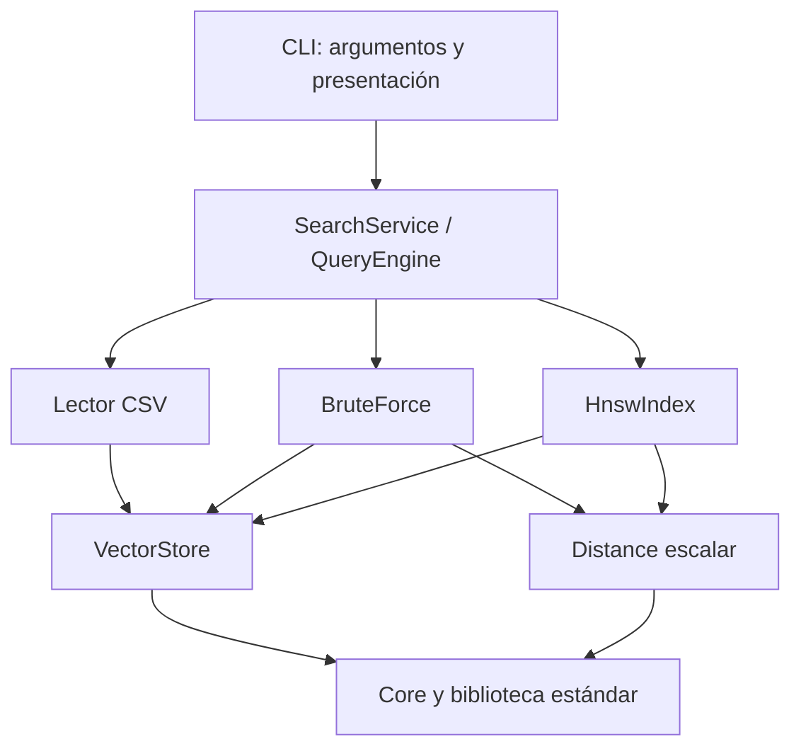
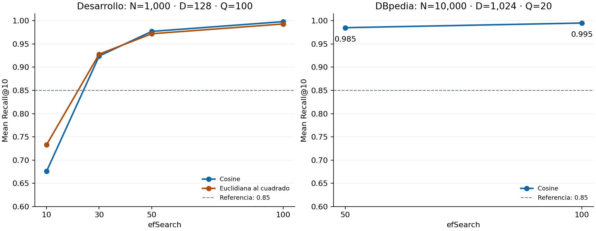

# AetherIndex — Informe técnico de avance del Sprint 1

> Evidencia histórica del baseline previo a las optimizaciones del 19-10-2026.
> Describe el código y las mediciones de esa versión; las cifras y salidas
> guardadas no se recalcularon. Para el contrato y resultados actuales, consultar
> [la validación de optimizaciones](../benchmarks/OPTIMIZATION_VALIDATION.md).

**Destinatario:** evaluación técnica externa.  
**Fecha de elaboración:** 19 de octubre de 2026.  
**Última validación:** 18 de octubre de 2026, America/Mexico_City; los metadatos conservan las marcas UTC.  
**Base de código:** `031adae19951d95ede349eaeaf295dd8d4a611d2`, más los instrumentos locales de aceptación identificados por SHA-256.  
**Alcance:** arquitectura, almacenamiento vectorial, distancias, búsqueda exacta, HNSW, integración y resultados reproducibles.

## 1. Dictamen técnico del avance

AetherIndex dispone de un **prototipo funcional de recuperación vectorial en
memoria implementado en C++20**. Puede almacenar embeddings FP32, calcular
distancias compartidas, ejecutar búsqueda exacta y aproximada, y presentar
resultados mediante una CLI. La visión de motor híbrido está definida, pero
BM25 y RRF todavía no están implementados.

La evidencia actual respalda tres conclusiones:

1. **Integridad y funcionamiento:** se recuperan exactamente 1,000 embeddings
   de 128 dimensiones; HNSW admite inserción incremental 500 + 500 y ejecuta
   100 consultas Top-10 válidas sin violaciones estructurales detectadas.
2. **Calidad de aproximación:** el protocolo de aceptación obtiene Mean
   Recall@10 **0.990** frente a una meta de **0.85**. Un caso adicional de
   10,000 artículos reales obtiene **0.985** y **0.995** a efSearch 50 y 100.
3. **Madurez pendiente:** faltan evaluación con múltiples semillas y órdenes
   de inserción, escalabilidad, medición formal de rendimiento y memoria,
   relevancia humana y ejecución multiplataforma. La CLI reconstruye el índice
   en cada proceso y HNSW emplea políticas simplificadas.

Por tanto, el avance es consistente con la aceptación técnica del núcleo del
Sprint 1. Estos resultados no acreditan todavía un motor híbrido completo,
aptitud de producción ni superioridad frente a bibliotecas de referencia.

## 2. Alcance implementado y arquitectura

| Componente | Estado y responsabilidad |
|---|---|
| `core` | `VectorId = uint32_t`, `EmbeddingValue = float` de 32 bits, `DistanceKind`, `SearchResult { id, distance }` |
| `storage` | VectorStore, propietario de embeddings contiguos y de la asociación ID–posición |
| `distance` | Implementaciones escalares de Cosine y SquaredEuclidean |
| `ann/brute_force` | Referencia exacta: recorrido exhaustivo, ordenamiento y Top-K |
| `ann/hnsw` | Grafo jerárquico, inserción, navegación, selección/poda y diagnóstico |
| `application` | `QueryEngine`, `SearchService`, carga y validación de CSV |
| `apps/cli` | Argumentos, errores, presentación tabular y tiempos |
| BM25, RRF, persistencia, servidor y generación de embeddings | Reservados o futuros; fuera de la implementación evaluada |



Los headers públicos se encuentran en `include/aether/`; las implementaciones,
en `src/`; las interfaces externas, en `apps/`. CMake compila bibliotecas por
módulo. Storage y Distance dependen únicamente de Core y la biblioteca
estándar; los algoritmos no dependen de la CLI. El ejecutable no tiene una
dependencia de ejecución con Python, NumPy ni un proveedor de modelos.

VectorStore conserva los embeddings. HNSW conserva IDs y topología y accede a
los vectores mediante `find()`: no mantiene una copia permanente de los
embeddings ni spans almacenados. El store debe sobrevivir al índice. La API
expone vistas de solo lectura y exige descartarlas antes de insertar; no se
permite solapar escrituras y lecturas. No se aporta validación de concurrencia.

**Código para contraste:** [CMake](../../CMakeLists.txt),
[tipos](../../include/aether/core/types.hpp),
[QueryEngine](../../src/application/query_engine.cpp) y
[SearchService](../../src/application/search_service.cpp).

## 3. Estructuras de datos y algoritmos

### 3.1. VectorStore: propiedad e integridad

La representación privada consta de `vector<float>` para componentes,
`vector<VectorId>` para IDs en orden de inserción y
`unordered_map<VectorId, size_t>` para resolver posiciones. Dimensión y función
de distancia se fijan en construcción; se rechazan dimensiones cero.

`insert(id, span)` devuelve `Success`, `DuplicateId`, `DimensionMismatch` o
`InvalidEmbedding`. Rechaza NaN/infinito y, para Cosine, vectores nulos. Acepta
el rango completo de IDs, incluido cero. `find(id)` devuelve un
`optional<span<const float>>`; la ausencia no produce un acceso inválido.

Cada inserción valida y copia temporalmente D componentes antes de modificar
el almacenamiento, lo que permite insertar desde una vista del mismo store.
Si una asignación falla, restaura los tamaños lógicos; las capacidades y la
validez de vistas anteriores pueden cambiar. Esta garantía no equivale a
preservar direcciones de memoria. La clase no se copia ni se mueve.

La consulta por ID tiene costo esperado O(1) del hash, no una garantía de peor
caso. Insertar requiere O(D) de validación/copia y puede ocasionar realocaciones.
El almacenamiento de componentes requiere 4ND bytes: 512,000 bytes para
1,000 × 128 y 40,960,000 bytes —39.06 MiB— para 10,000 × 1,024. Estas cifras
excluyen capacidad sobrante, IDs, hashes, grafo y memoria temporal; no son RSS
medida del proceso.

**Fuente:** [VectorStore](../../src/storage/vector_store.cpp).

### 3.2. Distancias escalares y semántica numérica

Para vectores no nulos de dimensión D:

```text
Cosine(q,v) = 1 − clamp((Σ qᵢvᵢ) / (sqrt(Σ qᵢ²) × sqrt(Σ vᵢ²)), −1, 1)
SquaredEuclidean(q,v) = Σ (qᵢ − vᵢ)²
```

Las dos funciones ordenan de menor a mayor. Se acumula en `double` y se
devuelve `float`. Cosine se restringe a [0,2]; SquaredEuclidean omite la raíz
cuadrada. Una distancia coseno cero expresa igual orientación, no exige
componentes idénticos. No se normalizan automáticamente los datos.

Se lanza `invalid_argument` ante dimensión vacía/desigual, valores no finitos,
función no soportada o norma nula en Cosine. Se lanza `overflow_error` si el
resultado euclidiano al cuadrado excede el rango finito de `float`.

Cada cálculo es O(D). Actualmente se vuelven a validar componentes y a calcular
normas en cada comparación; no existen kernels SIMD ni caché de normas. La
oportunidad de optimización debe confirmarse con perfiles.

Aunque la interfaz usa el término métrica, `1−cos` y L2² son disimilitudes que
no satisfacen en general la desigualdad triangular. Por ejemplo, en L2²,
`d(0,2)=4 > d(0,1)+d(1,2)=2`. El algoritmo implementado no usa una poda que
dependa de esa desigualdad.

**Fuente:** [scalar_distance.cpp](../../src/distance/scalar_distance.cpp).

### 3.3. BruteForce: referencia exacta

```text
Para cada ID de store.ids():
    recuperar la vista mediante store.find(ID)
    calcular la distancia compartida y guardar (ID, distancia)
ordenar los N resultados por distancia
devolver los primeros min(K,N)
```

El costo es **O(ND + N log N)** y utiliza O(N) memoria auxiliar para resultados.
No copia embeddings, pero calcula todas las distancias aunque K sea pequeño.
Los empates entre IDs no tienen un orden público garantizado. K=0 o store
vacío producen una respuesta vacía antes de validar la consulta.

“Exacto” significa exhaustivo sobre los componentes FP32 y la función
implementada. No implica precisión aritmética real ilimitada ni relevancia
semántica garantizada. El evaluador oficial agrega un desempate por ID; esta
regla no modifica el contrato del algoritmo de producción.

**Fuente:** [brute_force_index.cpp](../../src/ann/brute_force/brute_force_index.cpp).

### 3.4. HNSW: jerarquía, inserción y búsqueda aproximada

Cada nodo contiene ID, nivel máximo y listas de vecinos para las capas 0…L.
Los niveles se obtienen con `mt19937_64` y
`L = min(32, floor(−ln(U)/ln(M)))`, con U en (0,1) construido a partir de 52
bits aleatorios. La semilla fija permite repetir construcciones bajo el mismo
orden, configuración y entorno; no se certifica identidad entre plataformas.

| Parámetro utilizado | Valor | Función |
|---|---:|---|
| M | 16 | Límite de vecinos en capas superiores |
| M0 | 32 | Límite de vecinos en capa base |
| efConstruction | 100 | Amplitud de búsqueda durante inserción |
| efSearch | 50 | Amplitud de consulta predeterminada |
| Semilla del grafo | 42 | Generación de niveles |
| Nivel máximo permitido | 32 | Cota de seguridad; no significa 32 capas ocupadas |

**Inserción.** El ID debe existir en el store y no estar indexado. El primer
nodo se convierte en entry point. Las siguientes inserciones descienden por
capas superiores con búsqueda greedy de amplitud 1; en capas compartidas
buscan candidatos con efConstruction, seleccionan vecinos y agregan enlaces
en ambos sentidos. Se podan listas que exceden M/M0 y se actualiza el entry
point cuando aparece un nodo de mayor nivel.

**SEARCH-LAYER.** Mantiene un min-heap de candidatos, un max-heap de mejores
resultados y un conjunto de visitados. Explora vecinos y conserva hasta ef
resultados. Detiene la expansión cuando el conjunto está lleno y el candidato
pendiente más cercano ya es más lejano que el peor resultado conservado.

**Consulta.** Valida dimensión y valores incluso con índice vacío; K y efSearch
deben ser positivos. Desciende con ef=1 hasta capa 0 y usa allí
`ef = min(N, max(efSearch,K))`. Devuelve hasta K resultados alcanzables,
ordenados por `(distancia, ID)`. ef limita resultados retenidos, no el total
de nodos visitados. No existe fallback a BruteForce.

**Variantes y simplificaciones.** La selección retiene candidatos más cercanos,
equivalente al criterio simple del algoritmo 3 del artículo; no implementa su
heurística de diversidad del algoritmo 4. Además, en el código se seleccionan
hasta M0 conexiones iniciales en capa base y se transfiere únicamente el
candidato más cercano como entrada a la siguiente capa de inserción. El
algoritmo 1 del artículo distingue M de Mmax0 y transfiere el conjunto W. Estas
son variantes observables, no una reproducción literal de todo su pseudocódigo.
No se ha aislado experimentalmente su impacto individual. [Malkov y Yashunin,
algoritmos 1–5](https://arxiv.org/pdf/1603.09320).

La selección simple y la asimetría posterior a poda son admitidas por el
contrato MVP. Una arista inicialmente bidireccional puede conservarse en un
solo sentido. `validate_graph()` comprueba referencias, niveles, grados,
duplicados, autoenlaces, entry point y conteos; no establece conectividad
global ni alcanzabilidad de todos los nodos.

No se atribuye una garantía O(log N) a esta implementación. Si se efectúan V
evaluaciones de distancia, su trabajo es O(VD), además de recorrer aristas y
operar colas. Una capa puede evaluar hasta N nodos y un ID puede volver a
evaluarse en otra capa. El conjunto de visitados y la cola de candidatos
también pueden crecer con N. El grafo agrega almacenamiento de adyacencias y
estructuras dinámicas cuyo RSS todavía no se cuantificó.

**Errores durante mutación.** VectorStore y HNSW tienen garantías diferentes:
si HNSW falla después de iniciar una mutación, marca el índice como no utilizable
y exige reconstruirlo. No ofrece rollback del grafo. Los IDs duplicados o
ausentes se rechazan antes de mutar la topología.

**Fuentes:** [índice](../../src/ann/hnsw/hnsw_index.cpp),
[contrato público](../../include/aether/ann/hnsw/hnsw_index.hpp) y
[documentación del algoritmo](../algorithms/hnsw.md).

## 4. Diseño de la verificación

Se separaron tres protocolos. No se intercambian sus resultados ni se presenta
una consulta elegida para demostración como estimación general de calidad.

| Protocolo | Datos y consultas | Propósito |
|---|---|---|
| A. Aceptación | 1,000 × 128 FP32; 100 consultas; Cosine; semillas dataset/consulta/grafo 42/20261014/42 | Integridad, inserción 500 + 500, grafo, funcionalidad y umbral 0.85 |
| B. Desarrollo | 1,000 × 128; 100 consultas por métrica; consulta seed 424242; Cosine y L2²; efSearch 10/30/50/100 | Sensibilidad a amplitud de búsqueda con un grafo por métrica |
| C. DBpedia | 10,000 × 1,024; 20 artículos de consulta excluidos; Cosine; efSearch 50/100 | Aproximación en embeddings reales y contraste numérico independiente |

En A y B, `hnsw_test::embeddings` genera componentes deterministas con
`mt19937`; los IDs son `7×fila+10`, no consecutivos. Las consultas son distintas
de los embeddings indexados. El protocolo A conserva la configuración antes
de medir; su semilla de consultas se separó de la usada en desarrollo. Continúa
siendo un único dataset y una única semilla de grafo.

DBpedia procede de
[Qdrant/dbpedia-entities-openai3-text-embedding-3-small-1024-100K](https://huggingface.co/datasets/Qdrant/dbpedia-entities-openai3-text-embedding-3-small-1024-100K),
revisión `d49822cb2465295366349d414679b476997e88f5`. Se usan filas 0…9999 como
catálogo y 10000…10019 como consultas. El muestreo es determinista y no aleatorio;
no representa por sí solo todo el dominio. Se verificaron los SHA-256 de los
23 archivos preparados. Los embeddings se redondean a FP32; el motor no los
genera ni llama a un modelo.

Para cada consulta se calcula:

```text
Recall@10(q) = |Top10_exacto(q) ∩ Top10_HNSW(q)| / 10
Mean Recall@10 = suma de recalls / cantidad de consultas
```

En A, la referencia recorre los 1,000 vectores y se ordena por `(distancia, ID)`;
se observaron cero empates en el corte 10/11. En B se exige un corte sin empate.
El test HNSW real usa el Top-10 de BruteForce; no incorpora una política general
de equivalencia de conjuntos empatados en el corte.

Se requiere igualdad exacta para recuperar los componentes almacenados.
Los casos de referencia de distancias y el oráculo real aplican estrictamente
`abs(double(resultado) − double(referencia)) < 1e-5`; no `<=` ni una tolerancia
aplicada a los IDs. La comparación HNSW/BruteForce comparte el módulo Distance,
por lo que se complementa con un oráculo independiente en NumPy float64,
ranking redondeado a FP32 y empates sin orden obligatorio.

## 5. Resultados comprobados

### 5.1. Almacenamiento, invariantes y aceptación

| Indicador del protocolo A | Resultado del 18 de octubre |
|---|---|
| Inserciones / recuperación por ID | 1,000/1,000; 100 % |
| Componentes comparados | 128,000; igualdad FP32 exacta; cero embeddings alterados |
| Entradas inválidas y ausencia | Ocho comprobaciones; estado y contenido conservados |
| Inserción HNSW | 500 + 500 en una instancia; 500 IDs/niveles iniciales conservados |
| Diagnóstico y recorrido independiente | Cero violaciones después de 500, 1,000 y consultas |
| Nodos / nivel máximo observado | 1,000 / 2 |
| Consultas válidas | 100/100; diez IDs únicos y existentes; distancias finitas y ordenadas |
| Coincidencias exactas | 990/1,000 posiciones; 90 consultas con 10/10 y diez con 9/10 |
| Mean Recall@10 | **0.990 ≥ 0.85**; mínimo individual 0.9 |

La inyección de fallos de asignación de VectorStore ejerció **18 puntos de
fallo acumulados** en cinco tamaños iniciales, verificando rollback lógico y
reinserción posterior. No equivale a una campaña exhaustiva de fallos de
asignación sobre todas las mutaciones de HNSW. La invalidación del grafo ante
un fallo de distancia durante mutación sí tiene una prueba específica.

Evidencia: [VectorStore](evidence/2026-10-18/release/kr1_1_vectorstore_report.csv),
[HNSW funcional](evidence/2026-10-18/release/kr1_2_hnsw_functional_report.csv),
[recall de aceptación](evidence/2026-10-18/release/kr1_6_hnsw_recall_report.csv) y
[log detallado](evidence/2026-10-18/release/LastTest.log).

### 5.2. Sensibilidad de recall a efSearch

| efSearch | Mean Recall@10, Cosine | Mean Recall@10, L2² |
|---:|---:|---:|
| 10 | 0.676 | 0.733 |
| 30 | 0.924 | 0.928 |
| 50 | 0.977 | 0.972 |
| 100 | 0.998 | 0.993 |

Son resultados del protocolo B, con 100 consultas por celda. La configuración
de aceptación utiliza efSearch=50; los resultados con efSearch=10 muestran que
el umbral no es una propiedad incondicional del índice. A efSearch=50 el mínimo
individual de desarrollo fue 0.8 en ambas métricas, aunque los promedios
superaron 0.85. El criterio del Sprint se aplica al promedio.



La figura usa los mismos límites verticales en ambos paneles. Los segmentos
unen únicamente configuraciones medidas; no son una predicción entre puntos.
El conjunto oficial A, con otra semilla de consultas y promedio 0.990, no está
mezclado en la curva de desarrollo.

Fuente: [800 observaciones de desarrollo](evidence/2026-10-18/release/development_recall.csv).

### 5.3. Datos reales y exactitud independiente

| Configuración sobre DBpedia | Coincidencias | Mean Recall@10 | Mínimo individual |
|---|---:|---:|---:|
| Cosine, efSearch=50 | 197/200 | **0.985** | 0.9 |
| Cosine, efSearch=100 | 199/200 | **0.995** | 0.9 |

Se construyó un único grafo de 10,000 nodos, con nivel máximo observado 4, y se
evaluaron las mismas 20 consultas en ambos anchos. El grafo fue válido antes
y después. La consulta 14 permaneció en 9/10 en ambos casos: aumentar efSearch
no garantiza recuperar cada omisión.

En una comprobación independiente, BruteForce ejecutó 20 consultas por métrica
con K=100: **40/40 búsquedas y 4,000 vecinos verificados** contra NumPy. El error
absoluto máximo fue **5.99890916941348e-08 < 1e-5**. Se comprobaron IDs, ranking,
distancias impresas y checksums. Esa comprobación numérica no proporciona
etiquetas humanas de relevancia ni mide respuestas generadas por un LLM.

Fuentes: [recall real](evidence/2026-10-18/release/dbpedia_recall.csv),
[oráculo NumPy](evidence/2026-10-18/release/numpy_oracle.json) y
[procedencia/checksums](evidence/2026-10-18/release/dataset_manifest.json).

## 6. Rendimiento: observaciones y límites de interpretación

El test real del 18 de octubre separó carga, construcción y consultas. Sobre
el grafo preparado se observaron estas medias de 20 consultas:

| Operación | Tiempo observado |
|---|---:|
| Construcción de un grafo de 10,000 nodos | 26,183.397 ms |
| BruteForce, búsqueda exacta Top-10 | 10.408167 ms por consulta |
| HNSW, efSearch=50 | 1.156548 ms por consulta |
| HNSW, efSearch=100 | 1.850696 ms por consulta |

La CLI delimita `Query time` alrededor de `QueryEngine::search`, excluyendo CSV,
construcción y salida. Cada invocación vuelve a cargar el catálogo y a construir
HNSW. Por ello una menor duración de búsqueda no implica menor tiempo total
del comando. Como ilustración histórica separada, el ensayo CLI del **16 de
octubre**, consulta 0, midió 2.085 s del proceso exacto frente a 23.798 s del
proceso HNSW, con 21.779 s de construcción. [Registro de ese ensayo](../showcase/evidence/2026-10-16/rehearsal.json).

Estas observaciones **no constituyen un benchmark de producción**: distintas
configuraciones y hasta cuatro tests se ejecutaron en paralelo; no se controló
CPU, caché o carga, ni se realizaron suficientes repeticiones, múltiples
semillas, intervalos de confianza o comparación con otras bibliotecas. No se
acreditan QPS, latencia P95/P99, memoria máxima ni mejora porcentual universal.
Los tiempos totales de CTest incluyen oráculo, fixtures, procesos y aserciones.

## 7. Validación, entorno y trazabilidad

Entorno registrado: **macOS 26.5.2 ARM64**, CMake **4.4.4**, Python **3.13.5** y
NumPy **2.3.5** para el oráculo opcional. Release usa `-O3 -DNDEBUG`; Debug, `-g`.
No se registró el modelo de CPU ni la RAM total, otra limitación para comparar
rendimiento entre equipos.

| Ejecución nueva | Compilador | CTest | Tiempo total | Evidencia |
|---|---|---:|---:|---|
| Debug, suite base | AppleClang 17.0.0.17000603 | **18/18** | 33.98 s | [Log](evidence/2026-10-18/debug/ctest.log) |
| Release, base + datos reales | AppleClang 17.0.0.17000603 | **20/20** | 102.70 s | [Log](evidence/2026-10-18/release/ctest.log) |
| Debug + ASan/UBSan, suite base | Homebrew Clang 23.1.3 | **18/18** | 95.05 s | [Log](evidence/2026-10-18/sanitizers/ctest.log) |

Los sanitizadores se ejecutaron con detención ante errores; los logs no
contienen diagnósticos ASan/UBSan en los caminos ejercitados. Los dos tests
opcionales de DBpedia se ejecutaron en Release, no bajo sanitizadores. No se
aportan cobertura porcentual, fuzzing, pruebas de carga ni ejecución actual en
Windows/Linux. Las compilaciones sin tests tienen evidencia histórica del
[14 de octubre](../architecture/validation/okr1/no-tests/verification.json),
no una nueva ejecución en esta revisión.

Los tests cubren contratos de almacenamiento y distancias, alias y fallos de
asignación, casos límite de ambos algoritmos, poda y niveles, integración de
aplicación, errores CSV/argumentos y formato CLI. El K=0 de BruteForce devuelve
vacío; HNSW y la CLI exigen K positivo. Esa diferencia es explícita y probada.

**Estado de la entrega.** Los archivos de aceptación, scripts y documentación
siguen como modificaciones locales sin commit. El hash base por sí solo no
reconstruye esta entrega ampliada. Los tres `run_metadata.json` del paquete nuevo
identifican el estado del checkout y los SHA-256 de las fuentes, además de los
101 fixtures oficiales. El análisis posterior verificó igualdad de fuentes y
fixtures entre builds y hashes de los artefactos recopilados.

Se detectó una inconsistencia en la evidencia histórica del 14 de octubre: el
manifiesto de sanitizadores referencia `kr1_6_hnsw_recall_report.csv`, pero el
archivo presente tiene prefijo `kr1_3`. No se alteraron esos registros. Este
archivo renombrado sí conserva el SHA-256 de contenido esperado: la discrepancia
es de nomenclatura, no de resultados numéricos. Este
informe usa el **paquete nuevo del 18 de octubre**, con los nombres y hashes
comprobados. Versionar una entrega completa es una prioridad antes de remitir
el proyecto para reproducción externa.

Fuentes consolidadas: [resumen recalculado](evidence/2026-10-18/results_summary.json),
[metadatos de Release](evidence/2026-10-18/release/run_metadata.json) y
[analizador reproducible](evidence/2026-10-18/analyze_results.py). El
[manifiesto de revisión](evidence/2026-10-18/verification_manifest.json)
identifica los hashes del informe, la figura y las evidencias adjuntas.

## 8. Mejoras prioritarias y cómo evaluar su efecto

Las siguientes acciones son recomendaciones; no funcionalidades ya entregadas.

| Prioridad | Mejora | Justificación y criterio de aceptación propuesto |
|---|---|---|
| Alta | Versionar el snapshot evaluado y automatizar evidencia en CI | Incluir tests/scripts/documentos locales; exigir builds reproducibles, nombres/hashes válidos y no acreditar reportes antiguos después de una ejecución fallida |
| Alta | Reutilizar un índice preparado para varias consultas | Separar ciclo de carga/construcción del de búsqueda; demostrar una construcción y Q consultas en un proceso, conservando vida del store e invariantes |
| Alta | Ampliar evaluación de HNSW | Usar varias semillas, permutaciones de inserción, datos agrupados y más consultas; separar ajuste y prueba; informar medias, mínimos y dispersión del recall |
| Alta | Medir conectividad/alcanzabilidad | Contar nodos alcanzables desde el entry point en capa 0 y componentes; un reporte estructural válido no debe confundirse con cobertura del grafo |
| Media | Comparar políticas HNSW mediante ablación | Evaluar diversidad, M frente a M0 en nuevas conexiones y entrada W frente a un candidato; medir recall, construcción, distancias evaluadas y memoria bajo iguales condiciones |
| Media | Diseñar benchmarks controlados | Grafo reutilizado, calentamiento, repeticiones y ejecución aislada; registrar CPU/RAM/hilos, P50/P95/P99, QPS y RSS; comparar contra un motor de referencia con datos y métrica iguales |
| Media | Perfilar y después optimizar | Medir validaciones/normas repetidas, asignaciones de colas y visitados; estudiar cachés o rutas internas validadas sin debilitar el contrato público |
| Media | Reducir costo Top-K exacto | Evaluar selección parcial O(N) esperada más ordenamiento de K, o heap O(N log K); conservar exactitud y contrato de empates; verificar con el oráculo |
| Media | Fortalecer robustez y portabilidad | Inyección de fallos durante mutaciones HNSW, CSV adversarial/fuzzing y CI con GCC/MSVC; conservar los casos numéricos extremos y sanitizadores |
| Según Sprint 2 | Incorporar recuperación léxica e híbrida | Definir documentos/IDs comunes, implementar BM25 y después RRF; comparar relevancia con juicios humanos mediante métricas apropiadas, no solo recall ANN |

Para comparar con una biblioteca externa puede utilizarse
[Faiss](https://faiss.ai/), bajo condiciones equivalentes y con índice exacto
y aproximado según la comparación. No se ha ejecutado ese contraste; citar
una biblioteca no constituye evidencia de paridad de desempeño.

La calidad semántica requiere consultas representativas y documentos juzgados
por personas: coincidencia con BruteForce, Precision@K o nDCG responden preguntas
distintas. Los ejemplos reales muestran candidatos relacionados, pero también
vecinos discutibles; el recall ANN no acredita calidad de recomendaciones.

La reproducibilidad de datos también necesita atención: el preparador valida
una revisión fijada, pero su API de filas consulta la rama principal del
proveedor. Si cambia, rechazará la descarga. Se debe conservar la caché/snapshot
verificado y facilitar al evaluador los datos o una fuente inmutable; los
embeddings grandes están excluidos de Git.

## 9. Reproducción mínima para el evaluador

Se requiere el snapshot completo con los instrumentos locales, CMake ≥3.20 y
un compilador C++20. Desde la raíz del repositorio:

```sh
cmake -S . -B build-evaluador -DCMAKE_BUILD_TYPE=Release -DBUILD_TESTING=ON
cmake --build build-evaluador --parallel 4
ctest --test-dir build-evaluador -C Release --output-on-failure
```

La suite base no requiere red ni dependencias de tests externas. Para activar
los dos tests reales, preparar previamente el dataset y disponer de NumPy:

```sh
python3 scripts/prepare_real_dataset.py --offline
cmake -S . -B build-evaluador-real -DCMAKE_BUILD_TYPE=Release -DBUILD_TESTING=ON -DAETHER_REAL_DATA_DIR="$PWD/datasets/real/dbpedia"
python3 scripts/validate_sprint1_okr1.py --build-dir build-evaluador-real --config Release --output-dir build-evaluador-evidencia
```

`--offline` requiere la caché original. Si no existe, la preparación sin esa
opción descarga y verifica la revisión, sujeta al límite señalado en la sección
8. El recolector compila, ejecuta CTest y recalcula las intersecciones de IDs
antes de conservar los reportes. Utilizar un directorio de evidencia nuevo.

La revisión documental de los CSV guardados puede repetirse con:

```sh
python3 docs/reports/evidence/2026-10-18/analyze_results.py
```

Ese análisis verifica hashes y vuelve a calcular los resúmenes. Matplotlib es
opcional y únicamente genera la figura; no interviene en el motor ni en CTest.

## 10. Conclusión para la evaluación

El proyecto ha demostrado integración modular, propiedad explícita de memoria,
contratos numéricos controlados y una implementación jerárquica ANN contrastada
con búsqueda exhaustiva. La aceptación local del núcleo vectorial se cumple y
los resultados reales amplían la evidencia más allá de un ejemplo pequeño.

El siguiente avance técnico debería priorizar **entrega reproducible, índice
reutilizable y evaluación más amplia de HNSW**, antes de atribuirle capacidad
de producción o ventajas de rendimiento generales. La incorporación de BM25 y
RRF deberá conservar esta separación entre corrección, aproximación y relevancia.
La calificación externa, la revisión del equipo y el cierre formal del Sprint
no se deducen de las pruebas automatizadas.
