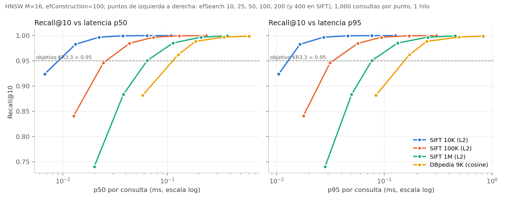

# Validación del OKR 3 — rendimiento ANN y kernels de distancia

**Fecha:** 30 de octubre de 2026 · **Rama:** `feature/market-benchmarks` (cambios sin commit)
**Entorno:** Apple M4 Pro (14 núcleos, 24 GB), macOS 26, AppleClang 17.0.0, Release
(`-O3`, `NDEBUG`), sin `-march=native`. Un hilo de búsqueda.
**Tablas completas:** [kr3_summary.md](../../evaluation/reports/kr3_summary.md), generado por
`scripts/summarize_kr3.py`. Comandos de reproducción en
[evaluation/README.md](../../evaluation/README.md).

## 1. Veredicto

| KR | Requisito | Resultado | Estado |
|---|---|---|---|
| KR3.1 | M, efConstruction, efSearch y K configurables sin recompilar; ≥ 3 valores de efSearch y ≥ 3 de M | CLI: `--m`, `--ef-construction`, `--ef-search`, `--k`; API: `HnswConfig` + `HnswIndex::search(q, k, ef)`. Probados M ∈ {8,16,32} × efSearch ∈ {10,50,100} y efConstruction ∈ {50,100,200} en DBpedia 9K, SIFT 10K y SIFT 100K | PASS |
| KR3.2 | ≥ 5 efSearch, tabla/gráfica Recall@10 vs p50/p95, ≥ 1,000 consultas | 5 valores (DBpedia) y 6 (SIFT) × 1,000 consultas; tabla + [gráfica](assets/kr3_recall_latency.svg) | PASS |
| KR3.3 | Recall@10 ≥ 0.95 | SIFT1M: **0.9505** con efSearch=50 (p50 0.064 ms), 0.9854 con 100; también en 10K, 100K y DBpedia | PASS |
| KR3.4 | Coseno y/o Euclidiana, rendimiento sobre ≥ 10,000 ejecuciones | Ambas; 500,000 llamadas medidas por kernel, variante y dimensión | PASS |
| KR3.5 | ≥ 1 kernel SIMD funcional y validado contra el escalar | NEON/FMA (ARM64); 80,000 pares por caso con error ≤ 4 % de la cota FP32 | PASS |
| KR3.6 | ≥ 20 % menos tiempo medio que el escalar (mismo dataset, compilador, hardware) | **88.3 % – 92.3 %** de reducción (8.5× – 12.9×) | PASS |
| KR3.7 | ≥ 10K y 100K vectores; extendido 1M | SIFT 10K, 100K y **1M** | PASS (incluye el objetivo extendido) |
| KR3.8 | p50, p95, p99 con ≥ 1,000 consultas tras warm-up | 100 búsquedas de warm-up y 1,000 medidas por configuración; latencias crudas por consulta | PASS |

## 2. Protocolo

**HNSW** (`aether_hnsw_parameter_sweep`):

- SIFT1M (TEXMEX, 128 d, L2). Se indexa el prefijo de 10,000, 100,000 o 1,000,000 filas de
  `sift_base.fvecs` y se miden las primeras 1,000 consultas de `sift_query.fvecs`, que nunca
  están indexadas. DBpedia (1,024 d, coseno) reserva 1,000 filas como consultas e indexa 9,000.
- La verdad de referencia es el Top-10 exacto de BruteForce sobre el mismo prefijo indexado.
- Se hacen 100 búsquedas de warm-up por configuración. El tiempo cubre solo
  `HnswIndex::search`. Los percentiles son de rango más cercano, `ceil(p·N)`.
- Se construye un grafo por par (M, efConstruction) y sirve para todos sus efSearch. A 10K/100K
  se construye en un hilo (reproducible). A 1M se usan 10 hilos (`insert_parallel`): la
  topología depende del planificador y la tabla lo registra.
- Regresión del driver: al volver a ejecutar DBpedia con el driver modificado se obtiene el
  **mismo Recall@10 en las 16 configuraciones** que la evidencia del Sprint 2.

**Kernels** (`aether_distance_kernel_benchmark`):

- La referencia escalar (`*_kernel_scalar`) es un bucle con un solo acumulador FMA y
  vectorización desactivada. Está en la misma biblioteca, se compila con el mismo compilador y
  los mismos flags que el kernel NEON, y ambos se llaman por puntero a función. El
  desensamblado ([evidencia](../../evaluation/reports/kr3_kernels/distance_kernels_disassembly.txt))
  muestra `fmadd s0` escalar en la referencia y `fmla.4s` en el kernel SIMD.
- Datos: 10,000 filas + 8 consultas por dimensión (gaussianas con semilla, d ∈ {100, 128, 384,
  768, 1024}) y las primeras 10,008 filas reales de SIFT1M. Los vectores se rellenan con ceros
  hasta un múltiplo de 16, como en la búsqueda.
- Cada repetición hace 10,000 llamadas. Hay 5 repeticiones de warm-up y 50 medidas, alternando
  el orden escalar/SIMD.
- Validación numérica: se compara SIMD contra escalar y contra `long double` sobre los mismos
  pares, frente a la cota FP32 `2·n·ε·Σ|término|`. `unit.distance` (CTest) repite la validación
  con longitudes 1–1536 que ejercitan las colas.

## 3. Resultados clave

### Recall@10 vs latencia (KR3.2, KR3.3, KR3.7, KR3.8)

| Escala | efSearch | Recall@10 | p50 ms | p95 ms | p99 ms | Construcción |
|---|---:|---:|---:|---:|---:|---:|
| SIFT 10K | 25 | 0.9828 | 0.013 | 0.016 | 0.021 | 1.0 s (1 hilo) |
| SIFT 100K | 50 | 0.9847 | 0.043 | 0.057 | 0.071 | 15.1 s (1 hilo) |
| SIFT 1M | 50 | 0.9505 | 0.064 | 0.076 | 0.086 | 27.5 s (10 hilos) |
| SIFT 1M | 100 | 0.9854 | 0.113 | 0.133 | 0.139 | 27.5 s (10 hilos) |
| DBpedia 9K | 25 | 0.9621 | 0.127 | 0.171 | 0.187 | 6.9 s (1 hilo) |

### Kernels (KR3.4, KR3.5, KR3.6)

| Datos | Métrica | Dim | Escalar ns | NEON ns | Reducción | máx \|SIMD−escalar\| |
|---|---|---:|---:|---:|---:|---:|
| SIFT1M | coseno | 128 | 69.80 | 7.28 | 89.6 % | 5.4e-07 |
| SIFT1M | L2² | 128 | 70.31 | 7.46 | 89.4 % | 0 |
| Sintético | coseno | 1024 | 800.96 | 66.26 | 91.7 % | 2.4e-07 |
| Sintético | L2² | 1024 | 840.50 | 64.98 | 92.3 % | 4.4e-03 (rel. ≤ 1.3e-06) |

## 4. Limitaciones

- Una sola máquina (ARM64/NEON) y una ejecución por configuración. La ruta AVX2/FMA de x86 está
  implementada, pero no se midió aquí; con `AETHER_NATIVE_SIMD=ON` en x86 se puede repetir el
  mismo benchmark.
- El speedup frente al escalar incluye el ancho SIMD (4 carriles) y el paralelismo de
  instrucciones de los 4 acumuladores. La referencia escalar está limitada por la latencia de
  su única cadena FMA. Es la comparación que pide KR3.6, pero no aísla el efecto del ancho SIMD
  por sí solo.
- A 1M solo se barrió efSearch (M=16, efConstruction=100). La rejilla completa de M se midió a
  10K y 100K. El grafo de 1M usa construcción paralela, que no es reproducible bit a bit.
- La carga del sistema no estaba aislada. Algunos p99 (por ejemplo, DBpedia M=16/efS=100) tienen
  *jitter*, y se reportan tal cual.
- `unit.bm25_allocation` agota su tiempo límite (60 s) en Release en este árbol. También fallaba
  antes de estos cambios (`build-optimization-release`, 16:04) y no tiene relación con OKR 3.
