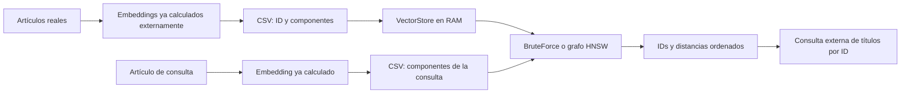

# AetherIndex — Guion de demostración del Sprint 1

> Evidencia histórica del baseline previo a las optimizaciones del 19-10-2026.
> Describe el código y las mediciones de esa versión; las cifras y salidas
> guardadas no se recalcularon. Para el contrato y resultados actuales, consultar
> [la validación de optimizaciones](../benchmarks/OPTIMIZATION_VALIDATION.md).

Preparado y ensayado el **16 de octubre de 2026**, para **macOS Terminal**, en
español. Duración sugerida: **35 minutos**, más preguntas. El guion combina una
introducción para principiantes con comandos de la versión actual.

La idea que debe quedar al terminar es esta:

> AetherIndex recibe representaciones numéricas del contenido y encuentra las
> más cercanas a una consulta. Podemos obtener una referencia exacta recorriendo
> todos los vectores, o buscar mediante un grafo HNSW y medir cuánto se aproxima
> a esa referencia.

## 1. Orden de la presentación

| Minutos | Qué mostrar | Qué debe entender la audiencia |
|---|---|---|
| 0–2 | Problema: encontrar contenido relacionado | Para qué sirve la recuperación vectorial |
| 2–8 | Texto, tokens, embeddings y generación | Qué aporta cada componente |
| 8–11 | Distancias y Top-K | Cómo se decide el orden de los resultados |
| 11–14 | Control numérico con cuatro vectores | Cómo leer archivos, IDs y tabla |
| 14–20 | Artículos reales y BruteForce | Recorrido completo de una búsqueda exacta |
| 20–25 | Los mismos artículos con HNSW | Construcción, navegación y tiempos separados |
| 25–29 | Caso con 9/10 y ampliación de búsqueda | Qué significa aproximado y cómo medirlo |
| 29–33 | Evidencia de aceptación | Qué comprobamos en el Sprint |
| 33–35 | Capacidades actuales y evolución | Qué se ha entregado y qué sigue |

No compiles ni descargues datos durante la exposición. Haz la preparación de
la sección 3 y conserva abiertas las salidas de respaldo. El caso principal
utiliza **10,000 artículos reales de 1,024 dimensiones**; el ejemplo de cuatro
vectores sirve únicamente para explicar la matemática y el formato.

## 2. Introducción que puedes explicar con tus palabras

### 2.1. Empezar con el problema

Puedes abrir así:

> Imaginemos una base de conocimiento con miles de artículos. Una persona está
> leyendo sobre un escuadrón aéreo y queremos sugerirle otros artículos
> relacionados. Necesitamos una representación del contenido que podamos
> comparar y un mecanismo para encontrar candidatos dentro del catálogo.
> Hoy mostraremos ese mecanismo en la primera versión de AetherIndex.

Una búsqueda por palabras identifica coincidencias léxicas; una búsqueda
vectorial compara representaciones aprendidas. Un ejemplo conceptual sería
relacionar “restablecer mi contraseña” con “recuperar el acceso a mi cuenta”.
La relación depende del modelo y del catálogo; ese ejemplo no es una consulta
que hayamos ejecutado en esta demo. La búsqueda semántica suele codificar
consulta y documentos en un espacio comparable y recuperar los vectores
cercanos. [Referencia: Sentence Transformers](https://www.sbert.net/examples/sentence_transformer/applications/semantic-search/README.html).

### 2.2. Qué es un vector y qué es un embedding

Un vector es una lista ordenada de números, por ejemplo `[0.2, -0.1, 0.7]`.
Tiene tres dimensiones porque contiene tres componentes. Una representación
con 1,024 dimensiones contiene 1,024 componentes; esa cantidad no indica el
número de palabras del artículo.

Un **embedding** es una representación numérica producida por un modelo. En
recuperación de texto buscamos que relaciones útiles entre contenidos se
reflejen en esas representaciones. Según el modelo, se pueden representar
oraciones, fragmentos o documentos mediante vectores de tamaño fijo.
[Referencia: documentación de embeddings de Sentence Transformers](https://www.sbert.net/docs/sentence_transformer/usage/usage.html).

Para entenderlo, piensa en un mapa: cada artículo tiene una ubicación y la
consulta tiene otra. Recuperamos ubicaciones cercanas. El mapa real tiene
muchas dimensiones y las coordenadas se aprenden; sus ejes no vienen
etiquetados como “aviación”, “finanzas” o “deportes”. Esta es una analogía para
la comparación, no una visualización literal del espacio de 1,024 dimensiones.

Los vectores de consulta y catálogo deben pertenecer a un espacio compatible:
normalmente se producen con el mismo modelo y configuración, o con encoders
entrenados para trabajar juntos. Tener la misma cantidad de componentes no
establece por sí solo esa compatibilidad. Esta condición la prepara quien
genera los embeddings; AetherIndex puede validar dimensión y valores, pero no
deducir de los números cuál fue el modelo que los produjo.

### 2.3. Cómo se relaciona esto con un LLM

Los vectores intervienen tanto en la generación como en la recuperación.
Para explicar un **LLM autorregresivo que genera texto**, sigue estos pasos:

1. **Tokenización.** El texto se separa en tokens: pueden ser palabras,
   fragmentos, signos u otras unidades del tokenizador. Cada token se asocia
   con un ID del vocabulario. Una palabra no equivale siempre a un token.
   [Referencia: tokenizadores de Hugging Face](https://huggingface.co/learn/llm-course/en/chapter2/4).
2. **Representación.** Los IDs se convierten en vectores aprendidos y el modelo
   incorpora información de posición.
3. **Contexto.** Capas de atención y transformaciones neuronales actualizan las
   representaciones usando el contexto permitido. Esto ayuda a representar
   usos distintos de una palabra, como “banco” en una conversación financiera
   y en una descripción de un parque.
4. **Predicción.** Una transformación final produce puntuaciones para tokens
   posibles; softmax las convierte en una distribución de probabilidades del
   siguiente token. La atención y la salida probabilística son partes del
   modelo aprendido. [Referencia: Transformer, secciones 3.2–3.5](https://arxiv.org/html/1706.03762v7).
5. **Decodificación.** Una estrategia elige el siguiente token, lo añade al
   contexto y repite el proceso hasta terminar. Puede seleccionar el de mayor
   puntuación o utilizar muestreo. [Referencia: generación con LLMs](https://huggingface.co/learn/llm-course/en/chapter1/8).

```text
Texto → tokens → IDs de vocabulario → representaciones contextuales
      → probabilidades del siguiente token → selección → repetición
```

Durante el entrenamiento se ajustan parámetros para aprender patrones; en
la inferencia habitual se utilizan los parámetros ya entrenados.
[Referencia: entrenamiento e inferencia](https://huggingface.co/learn/llm-course/en/chapter1/4).

Ejemplo inventado para explicar el mecanismo: después de “El avión”, un modelo
podría asignar distintas probabilidades a “voló”, “aterrizó” y otros tokens.
Esas probabilidades describen continuaciones del texto. No son una medición de
la verdad de una afirmación ni se obtienen ordenando los artículos de nuestra
base de datos por distancia.

El embedding de un artículo para búsqueda y las representaciones internas de
tokens de un generador cumplen tareas distintas. Nuestro catálogo proporciona
un vector completo por artículo; AetherIndex compara esos vectores ya calculados.

### 2.4. Ubicar AetherIndex en un sistema mayor

El recorrido de esta versión es:



En una aplicación RAG, un recuperador puede suministrar contenido a un LLM
para que genere una respuesta apoyada en lo recuperado. Ese recorrido combina
recuperación y generación. [Referencia: artículo original de RAG](https://arxiv.org/abs/2005.11401).

En este Sprint se implementó el almacenamiento y la recuperación vectorial.
La CLI recibe CSV; la generación de embeddings y de respuestas, la entrada de
preguntas en lenguaje natural y la consulta de textos completos quedan fuera
de este comando. El script de presentación que acompaña este guion consulta
metadata externa para asociar IDs con títulos.

### 2.5. Cómo interpretamos una distancia

Una vez que consulta y artículos son vectores, necesitamos una regla de
comparación. Esta versión ofrece dos:

| Métrica | Regla | Interpretación |
|---|---|---|
| Cosine | `1 − (q · v) / (||q|| × ||v||)` | Compara orientación; menor distancia indica mayor alineación |
| SquaredEuclidean | `sum((q[i] − v[i])²)` | Compara diferencias de coordenadas, sin calcular raíz cuadrada |

En Cosine, 0 indica la misma dirección, 1 corresponde a vectores ortogonales y
2 a direcciones opuestas. Misma dirección no exige componentes idénticos:
`[1,0]` y `[10,0]` tienen distancia coseno cero. Tampoco demuestra que dos
textos sean intercambiables. Una distancia no es un porcentaje de relevancia.
Los vectores completamente nulos se rechazan en Cosine porque su norma hace
indefinida la división.

**Top-K** significa los K candidatos con menor distancia. K es la cantidad
solicitada; el catálogo limita cuántos pueden existir. Si pedimos 100 y hay
cuatro embeddings, la búsqueda exacta devuelve cuatro.

La fuente de estas reglas en el proyecto es el contrato de
[distancias](../algorithms/vector_store_and_distances.md) y la implementación
escalar, que acumula en `double` y devuelve `float`.

## 3. Preparación antes de presentar

### 3.1. Compilar y verificar

Ejecuta en macOS Terminal:

```sh
cd /Users/estebangonzalezcervantes/Documents/aetherindex
cmake -S . -B build-showcase -DCMAKE_BUILD_TYPE=Release -DBUILD_TESTING=ON
cmake --build build-showcase --parallel 4
mkdir -p build-showcase/evidence
./build-showcase/aetherindex --help
ctest --test-dir build-showcase -C Release -R sprint1_okr1 --output-on-failure
```

Release permite observar el comportamiento sin la instrumentación de un build
de depuración o sanitizadores. Las pruebas seleccionadas verifican el protocolo
de aceptación y su integración con la CLI. En el ensayo del 16 de octubre
pasaron **2/2**. La suite completa histórica del 14 de octubre pasó 18/18 en
Debug, Release y ASan/UBSan, como registra el informe del Sprint.

### 3.2. Tener los datos reales disponibles

Los archivos preparados de DBpedia ya existen en este Mac y sus **23 checksums**
se comprobaron durante este ensayo. Verifica el contexto con:

```sh
python3 scripts/showcase_results.py --query-index 0
```

El catálogo tiene 10,000 artículos y 20 consultas externas al catálogo. Los
embeddings publicados corresponden a `text-embedding-3-small`, configurados a
1,024 dimensiones. Se conserva la revisión
`d49822cb2465295366349d414679b476997e88f5` del
[dataset de Qdrant en Hugging Face](https://huggingface.co/datasets/Qdrant/dbpedia-entities-openai3-text-embedding-3-small-1024-100K).

Si preparas otra máquina, utiliza antes de presentar:

```sh
python3 scripts/prepare_real_dataset.py
```

Si ya tienes las páginas originales en caché, puedes regenerar sin red:

```sh
python3 scripts/prepare_real_dataset.py --offline
```

La preparación inicial necesita red, espacio para varios cientos de MB y
tiempo para descargar. Los datos preparados no se incluyen en Git. Ninguno de
los comandos `search` de la demostración descarga modelos ni utiliza una API.

### 3.3. Preparar la pantalla

Usa un tamaño de letra legible, abre el guion y ten preparada la carpeta de
evidencias. Evita mostrar una fila entera de 1,024 componentes; aporta ruido
visual. Explica el formato con el archivo pequeño y el tamaño real mediante
la metadata.

Para guardar la salida y verla al mismo tiempo usaremos `tee`. Activa en esa
terminal:

```sh
set -o pipefail
```

Así un error del motor no queda oculto por una ejecución correcta de `tee`.
La opción no activa la terminación automática de la terminal ante un error.

## 4. Demostración en vivo, paso a paso

### Paso 1 — Mostrar la interfaz

```sh
./build-showcase/aetherindex --help
```

**Qué decir:**

> Esta interfaz ejecuta una búsqueda por proceso. Elegimos un catálogo, una
> consulta, una métrica, un algoritmo y cuántos vecinos queremos. El programa
> devuelve IDs y distancias. Es una forma directa de observar el motor.

Explica únicamente `--dataset`, `--query`, `--algorithm`, `--metric` y `--k`
al principio. Los parámetros de HNSW tendrán sentido después de explicar el
grafo. La ayuda y los nombres de campos permanecen en inglés en la CLI actual.

### Paso 2 — Leer el formato con un control pequeño

```sh
cat datasets/examples/vectors.csv
cat datasets/examples/query.csv
```

El catálogo contiene:

```csv
10,1.0,0.0
20,0.0,1.0
30,-1.0,0.0
40,0.8,0.6
```

La consulta contiene:

```csv
1.0,0.0
```

Cada fila del catálogo representa **un vector**. El primer valor es su ID y
los dos restantes son componentes. La consulta es un único vector de dos
componentes y no incluye ID. Por tanto, `10` identifica `[1,0]`; `10` no es una
coordenada ni el número de vectores. Los IDs del catálogo son únicos.

```sh
./build-showcase/aetherindex search --dataset datasets/examples/vectors.csv --query datasets/examples/query.csv --algorithm brute-force --metric cosine --k 100
```

Los tiempos varían; los resultados ensayados son:

```text
Vectors indexed: 4
Dimensions: 2
Requested K: 100
Results returned: 4

+------+-----------+-------------+
| Rank | Vector ID | Distance    |
+------+-----------+-------------+
|    1 |        10 | 0.000000000 |
+------+-----------+-------------+
|    2 |        40 | 0.200000003 |
+------+-----------+-------------+
|    3 |        20 | 1.000000000 |
+------+-----------+-------------+
|    4 |        30 | 2.000000000 |
+------+-----------+-------------+
```

La orientación de `[1,0]` coincide con la consulta; `[0.8,0.6]` está más
alineado que `[0,1]`; `[-1,0]` apunta al sentido opuesto. La tabla ordena por
distancia, por eso los IDs aparecen 10, 40, 20, 30.

`0.200000003` refleja la representación y el redondeo de `float`. Mostrar
nueve decimales fija la presentación, pero no aumenta la precisión de los
números almacenados. La desviación respecto al 0.2 matemático es menor que
`1e-5`. Las columnas distinguen ranking, identificador y distancia.

Si quieres contrastar métricas, este paso es opcional:

```sh
./build-showcase/aetherindex search --dataset datasets/examples/vectors.csv --query datasets/examples/query.csv --algorithm brute-force --metric squared-euclidean --k 4
```

Devuelve distancias `0.000000000`, `0.400000036`, `2.000000000` y `4.000000000`.
Para el vector 40, la referencia matemática es
`(1 − 0.8)² + (0 − 0.6)² = 0.4`. Este catálogo particular mantiene el orden;
otros datos pueden producir rankings distintos entre métricas.

### Paso 3 — Presentar el caso real antes de ejecutar

```sh
python3 scripts/showcase_results.py --query-index 0
```

**Qué decir:**

> Ahora usaremos 10,000 artículos reales. El artículo de consulta es
> “40th Flight Test Squadron”, una unidad de la Fuerza Aérea de Estados Unidos.
> Su embedding tiene 1,024 componentes y está excluido del catálogo. Buscaremos
> los diez artículos del catálogo que están más cerca de él en este espacio.

Es un caso de **recomendación de contenido relacionado**. El artículo completo
se representó previamente; no estamos escribiendo una nueva pregunta en
lenguaje natural ni generando un embedding durante esta ejecución.

### Paso 4 — Obtener una referencia exacta con BruteForce

```sh
./build-showcase/aetherindex search --dataset datasets/real/dbpedia/vectors.csv --query datasets/real/dbpedia/queries/query_00.csv --algorithm brute-force --metric cosine --k 10 | tee build-showcase/evidence/dbpedia-query00-brute-force.txt
```

**Qué hace el motor y por qué:**

1. La capa de aplicación lee y valida los CSV.
2. `VectorStore` conserva los embeddings en memoria, asociados a sus IDs.
3. BruteForce calcula la distancia entre la consulta y **cada uno de los 10,000
   vectores**.
4. Ordena todos los resultados de menor a mayor y conserva los primeros diez.
5. La CLI imprime la respuesta después de que la operación termine correctamente.

La búsqueda es exacta respecto a los componentes FP32, la métrica y los
cálculos implementados. “Exacta” describe la vecindad matemática; el modelo y
el catálogo determinan qué tan útiles son esos vecinos para una persona.
En empates, BruteForce no promete un orden particular entre IDs empatados.

En esta implementación, el recorrido de distancias cuesta aproximadamente
`O(N × D)` y el ordenamiento completo `O(N log N)`. K=10 no reduce a diez la
cantidad de vectores comparados. En nuestro caso se examinan 10,000 vectores,
cada uno de 1,024 componentes.

### Paso 5 — Relacionar los IDs con artículos reconocibles

```sh
python3 scripts/showcase_results.py --query-index 0 --results build-showcase/evidence/dbpedia-query00-brute-force.txt
```

Resultados iniciales del ensayo:

| Rank | Vector ID | Artículo | Distancia coseno |
|---|---:|---|---:|
| 1 | 33743 | No. 40 Squadron RAAF | 0.511461020 |
| 2 | 48471 | 453d Electronic Warfare Squadron | 0.539448142 |
| 3 | 18175 | 380th Air Expeditionary Wing | 0.552062094 |

**Qué decir:**

> Varios vecinos son otras unidades aéreas. Ahora podemos interpretar los IDs
> como referencias a contenido concreto. La ordenación proviene de las
> distancias entre embeddings.

Este script es una **ayuda externa de presentación**: une los IDs de una
salida ya guardada con `articles.jsonl`. No cambia el ranking, no ejecuta otra
búsqueda y no añade un DocumentStore a la CLI. Los títulos no forman parte de
la tabla nativa del motor.

Inspecciona también resultados menos evidentes: aparece “B46 nuclear bomb” en
la quinta posición. La vecindad del embedding puede incluir contenido que una
persona considere poco pertinente. Una evaluación humana de recomendaciones
necesita criterios de relevancia adicionales.

### Paso 6 — Explicar HNSW antes de ponerlo a trabajar

Puedes decir:

> Ya tenemos una referencia exacta. Para catálogos mayores queremos encontrar
> candidatos sin recorrer siempre todos los vectores. HNSW construye un grafo:
> cada nodo identifica un embedding y se conecta con otros nodos. Sus capas
> superiores ayudan a acercarse a una región, y la capa base explora candidatos
> alrededor de esa región.

Como analogía, imagina que usas carreteras principales para acercarte a una
zona y calles locales para explorarla. El grafo es una estructura de
proximidad aprendida mediante inserciones y distancias, no un mapa de países ni
una taxonomía manual. Su jerarquía utiliza niveles aleatorios.
[Referencia: artículo original de HNSW](https://arxiv.org/abs/1603.09320).

En AetherIndex, todos los nodos participan en capa 0. Algunos aparecen además
en capas superiores. La consulta empieza en el entry point, desciende con
búsqueda greedy y explora candidatos en la capa base con colas y un conjunto
de visitados. HNSW utiliza la misma función de distancia que BruteForce. Los
nodos guardan IDs y conexiones; los embeddings pertenecen a VectorStore.

El resultado es aproximado porque esa navegación puede omitir alguno de los
vecinos exactos. El costo depende del grafo, los datos y los parámetros; esta
demostración no establece una garantía universal de complejidad o rendimiento.

### Paso 7 — Ejecutar HNSW sobre los mismos datos

```sh
./build-showcase/aetherindex search --dataset datasets/real/dbpedia/vectors.csv --query datasets/real/dbpedia/queries/query_00.csv --algorithm hnsw --metric cosine --k 10 --m 16 --m0 32 --ef-construction 100 --ef-search 50 --seed 42 | tee build-showcase/evidence/dbpedia-query00-hnsw-50.txt
```

Mientras se construye, explica los parámetros:

| Parámetro | Papel en esta versión |
|---|---|
| `--k 10` | Cantidad solicitada de vecinos finales |
| `--m 16` | Límite de conexiones por nodo en capas superiores |
| `--m0 32` | Límite de conexiones por nodo en capa base |
| `--ef-construction 100` | Amplitud de candidatos durante inserción |
| `--ef-search 50` | Amplitud de candidatos retenidos durante búsqueda |
| `--seed 42` | Semilla de los niveles aleatorios del grafo |

M y M0 son límites, no un conteo exacto que todos los nodos deban tener.
`efSearch=50` tampoco significa que se visiten exactamente 50 nodos ni que se
devuelvan 50 resultados. La implementación usa `min(N, max(efSearch, K))` como
amplitud efectiva. Los resultados devueltos siguen limitados por K, los nodos
existentes y la conectividad alcanzable.

Métrica, catálogo y consulta se mantuvieron iguales para que la comparación
sea interpretable. La misma semilla, configuración de construcción, orden y
entorno permiten repetir el grafo. Esta semilla no controla la generación de
texto de un LLM ni crea los embeddings del catálogo.

```sh
python3 scripts/showcase_results.py --query-index 0 --results build-showcase/evidence/dbpedia-query00-hnsw-50.txt --reference build-showcase/evidence/dbpedia-query00-brute-force.txt
```

En el ensayo recuperó **10/10** IDs del Top-10 exacto para esta consulta. Que
los dos rankings coincidan en este caso no significa que HNSW haya recorrido
todos los vectores ni que lo haga siempre. No existe fallback de fuerza bruta
en esta ruta del producto.

### Paso 8 — Separar los tiempos correctamente

| Medición local del 16 de octubre | BruteForce, consulta 0 | HNSW, consulta 0 |
|---|---:|---:|
| Tiempo de búsqueda mostrado por la CLI | 10.659250 ms | 0.875666 ms |
| Construcción de grafo mostrada por la CLI | No aplica | 21,778.826333 ms |
| Proceso completo, medido externamente en el ensayo | 2.085 s | 23.798 s |

**Qué decir:**

> El tiempo de búsqueda empieza cuando el store y, para HNSW, el grafo ya están
> preparados. La espera que acabamos de observar también incluye leer el CSV y
> construir el índice. Esta CLI reconstruye el grafo en cada invocación, por
> eso el comando HNSW completo tardó más que fuerza bruta en este ensayo.

La biblioteca permite consultar un índice ya construido en el mismo proceso;
ese es el patrón que puede amortizar el costo de construcción con muchas
consultas. La CLI actual ejecuta una consulta por proceso, sin reutilización
entre invocaciones ni persistencia. No presentes ese patrón futuro como una
capacidad ya disponible del comando `search`.

Los tiempos anteriores son observaciones locales de una ejecución, no un
benchmark comparativo ni una promesa de latencia en otra máquina. La cantidad
de decimales impresos tampoco garantiza esa precisión del reloj.

### Paso 9 — Mostrar una aproximación imperfecta y su medición

Este bloque es opcional si dispones de menos tiempo. Usa la consulta 13 para
mostrar una diferencia observable; la seleccionamos como ejemplo explicativo,
no como muestra representativa de calidad.

```sh
python3 scripts/showcase_results.py --query-index 13
./build-showcase/aetherindex search --dataset datasets/real/dbpedia/vectors.csv --query datasets/real/dbpedia/queries/query_13.csv --algorithm brute-force --metric cosine --k 10 | tee build-showcase/evidence/dbpedia-query13-brute-force.txt
./build-showcase/aetherindex search --dataset datasets/real/dbpedia/vectors.csv --query datasets/real/dbpedia/queries/query_13.csv --algorithm hnsw --metric cosine --k 10 --m 16 --m0 32 --ef-construction 100 --ef-search 50 --seed 42 | tee build-showcase/evidence/dbpedia-query13-hnsw-50.txt
python3 scripts/showcase_results.py --query-index 13 --results build-showcase/evidence/dbpedia-query13-hnsw-50.txt --reference build-showcase/evidence/dbpedia-query13-brute-force.txt
```

El artículo es “MacRobertson's”. En el ensayo, la referencia incluye el ID
13163, mientras HNSW a efSearch=50 omite ese vecino e incluye el ID 51012.
La intersección tiene nueve IDs:

`Recall@10 = |Top10_exacto ∩ Top10_HNSW| / 10 = 9/10 = 0.900`.

Amplía la exploración y mantén las demás condiciones:

```sh
./build-showcase/aetherindex search --dataset datasets/real/dbpedia/vectors.csv --query datasets/real/dbpedia/queries/query_13.csv --algorithm hnsw --metric cosine --k 10 --m 16 --m0 32 --ef-construction 100 --ef-search 100 --seed 42 | tee build-showcase/evidence/dbpedia-query13-hnsw-100.txt
python3 scripts/showcase_results.py --query-index 13 --results build-showcase/evidence/dbpedia-query13-hnsw-100.txt --reference build-showcase/evidence/dbpedia-query13-brute-force.txt
```

En este caso pasó a **10/10**. El tiempo de búsqueda observado pasó de
1.009625 ms a 1.679459 ms. Ampliar la búsqueda puede mejorar recall y aumentar
trabajo; no promete una mejora en todas las consultas. Cada comando volvió a
construir un grafo con las mismas condiciones de construcción.

Los títulos de este caso también muestran que un recall alto frente a
BruteForce no equivale a buenas recomendaciones humanas: varios vecinos son
personas con nombres relacionados, aunque el artículo describe una empresa
de confitería. El catálogo es un subconjunto de la fuente y no tiene etiquetas
humanas de relevancia. Aquí medimos fidelidad a la vecindad exacta, no la calidad
semántica absoluta del modelo o la cobertura del catálogo.

### Paso 10 — Mostrar validación repetible, no solo una consulta favorable

```sh
ctest --test-dir build-showcase -C Release -R '^integration.sprint1_okr1$' --output-on-failure -V
```

Busca las líneas `KR1.1`, `KR1.2` y `KR1.6`:

| Protocolo de aceptación | Resultado |
|---|---|
| 1,000 embeddings sintéticos de dimensión 128 | 1,000 recuperados sin alteraciones |
| Integridad | 128,000 componentes FP32 comparados exactamente |
| Inserción incremental HNSW | 500 + 500, conservando los primeros 500 nodos |
| Consultas independientes | 100 Top-10 válidos, sin errores ni violaciones del grafo |
| Mean Recall@10, Cosine, efSearch=50 | **0.990**, mínimo requerido **0.85** |

**Qué decir:**

> Los artículos reales nos permiten interpretar el funcionamiento. El protocolo
> reproducible nos permite comprobar almacenamiento, estructura y fidelidad a
> fuerza bruta con cien consultas independientes. En ese protocolo obtuvimos
> 990 coincidencias de 1,000 posiciones evaluadas.

El promedio es 99 % de coincidencias con los vecinos exactos en ese conjunto;
no significa 99 % de respuestas correctas de un LLM, ni 99 % de relevancia
humana, ni un resultado garantizado para cualquier dataset. Tampoco debe
atribuirse ese 0.990 a las dos consultas reales que acabamos de mostrar.

El [informe del Sprint](../architecture/SPRINT_1_OKR1_VALIDATION.md) conserva
los CSV y la evidencia completa. El tiempo total de CTest incluye preparación
y comprobaciones; no se utiliza como tiempo de consulta.

### Paso 11 — Opcional: una entrada inválida controlada

```sh
./build-showcase/aetherindex search --dataset datasets/examples/vectors.csv --query datasets/examples/query.csv --algorithm brute-force --k 0
echo $?
```

K debe ser positivo: se obtiene un mensaje de argumentos inválidos y código
**2**, sin resultados parciales. Si prefieres demostrar dimensión incompatible:

```sh
printf '1,0,0\n' > build-showcase/query-wrong-dimension.csv
./build-showcase/aetherindex search --dataset datasets/examples/vectors.csv --query build-showcase/query-wrong-dimension.csv --algorithm brute-force --k 2
echo $?
```

La consulta tiene dimensión 3 y el catálogo dimensión 2; se rechaza con código
**3**. El error esperado es parte de la demostración del contrato, no un fallo
inesperado del programa. Ejecuta `echo $?` inmediatamente después del comando
para observar su código de salida.

### Paso 12 — Cerrar con el avance concreto

Puedes terminar así:

> En este Sprint construimos el núcleo de recuperación vectorial: almacenamiento
> en memoria, distancias compartidas, una referencia exacta y HNSW, expuestos por
> una CLI. Pudimos cargar embeddings reales, recuperar candidatos y medir la
> aproximación contra una referencia verificable. Esto establece una base para
> incorporar recuperación léxica y fusión de rankings en el siguiente Sprint.

La visión del proyecto es un motor híbrido. El avance mostrado corresponde al
núcleo vectorial; BM25 y RRF siguen en el alcance futuro. También quedan fuera
la generación de embeddings, respuestas de un LLM, persistencia, servidor,
actualizaciones/eliminación, concurrencia y optimizaciones SIMD. El informe
técnico prepara el cierre; la revisión y aprobación del equipo corresponden a
la Sprint Review.

## 5. Preguntas previsibles

**¿Puedo escribir una pregunta directamente en la CLI?**
El comando actual recibe el embedding de la consulta en un CSV. Una aplicación
de preguntas necesitaría generar ese embedding con un modelo compatible antes
de llamar al motor.

**¿Por qué no aparece una distancia cero en el caso real?**
El artículo de consulta está excluido del catálogo. Estamos comparándolo con
artículos diferentes, no recuperando una copia idéntica. La exclusión no
garantiza matemáticamente una distancia positiva en cualquier espacio, pero
en estas consultas las distancias observadas son positivas.

**¿Por qué una distancia de 0.51 puede quedar primera?**
Porque es la menor entre los candidatos del catálogo. Top-K es una selección
relativa; esta CLI no aplica un umbral de relevancia ni permite interpretar
0.51 como una probabilidad.

**¿Si HNSW devuelve los mismos diez, es exacto?**
El algoritmo sigue siendo aproximado. Una coincidencia completa es una
observación de esa consulta y configuración; la consulta 13 permite observar
una omisión a efSearch=50.

**¿efSearch=100 devuelve cien artículos?**
K determina el máximo de resultados solicitado. efSearch gobierna la amplitud
de candidatos; con K=10 seguimos solicitando diez artículos.

**¿Por qué no basta con aumentar efSearch siempre?**
Una exploración mayor puede requerir más trabajo. Se debe evaluar el equilibrio
con múltiples consultas, datos representativos y medidas apropiadas.

**¿Aumentar dimensiones siempre mejora la búsqueda?**
El modelo y su entrenamiento determinan la representación. La dimensión
también aumenta almacenamiento y trabajo de distancia; es una decisión que
se evalúa con el caso de uso, no una garantía de mejor calidad.

**¿Al volver a ejecutar conserva el índice?**
Cada proceso carga de nuevo los CSV y, con HNSW, construye de nuevo el grafo.
La reutilización de una instancia dentro de un proceso está disponible en la
biblioteca; la CLI no conserva esa instancia entre comandos.

**¿Qué parte aporta C++ aquí?**
El proyecto implementa estructuras y cálculos con control explícito de
memoria y tipos. VectorStore conserva componentes contiguos y los algoritmos
acceden mediante vistas. El rendimiento concreto necesita medición; el lenguaje
por sí solo no acredita superioridad frente a otros motores.

## 6. Versión abreviada de 15 minutos

Dedica cuatro minutos al problema, embeddings y la separación entre generación
y recuperación; dos minutos a la tabla pequeña; cuatro a DBpedia con fuerza
bruta y títulos; tres a HNSW y sus tiempos; dos al resultado de aceptación y
próximos pasos. Omite la segunda métrica, la consulta 13, los errores controlados
y los detalles internos de las colas. Conserva la distinción entre tiempo de
búsqueda y tiempo total, y entre recall algorítmico y relevancia humana.

## 7. Respaldo y evidencia del ensayo

Las cinco búsquedas reales del 16 de octubre terminaron con código 0 y stderr
vacío. Los comandos exactos y tiempos externos están en
[`evidence/2026-10-16/rehearsal.json`](evidence/2026-10-16/rehearsal.json).

Si necesitas continuar con una salida guardada, anúnciala como un **resultado
del ensayo del 16 de octubre**, no como una ejecución en vivo:

```sh
cat docs/showcase/evidence/2026-10-16/dbpedia-query00-hnsw-50.txt
python3 scripts/showcase_results.py --query-index 0 --results docs/showcase/evidence/2026-10-16/dbpedia-query00-hnsw-50.txt --reference docs/showcase/evidence/2026-10-16/dbpedia-query00-brute-force.txt
```

El segundo comando necesita los archivos de metadata locales. Los respaldos
incluyen salidas numéricas y comandos, no los 140 MB del CSV de embeddings.
Los datos fuente, las salidas de ensayo y las pruebas de aceptación se mantienen
como evidencias distintas. No se modificaron los algoritmos para preparar
esta presentación.
